# NeuroVLM revision: responses to the reviewers

One short response per reviewer comment, in the order of the review summary. Each says what we did and what we found, shows the figure or table if there is one, and ends with a hidden comment naming the script behind it. Every evaluation leaves out the duplicated papers found by the leakage audit ([2.4](#2.4)).

The figures and tables of each reviewer's comments are copied into `reviewer_01/` to `reviewer_03/` (named by comment). The analyses that make them are in `core/`, the paper figures in `../main/`. The letter to the editor comes first. The LaTeX response letter built from this file is `response_letter.tex` (same words and links, figures numbered R1, R2, ... as in the image alt texts). Figure and table captions are written in the letter only, `build_reviewer_dirs.py` copies the figure captions into the reviewer folders, and `check_letter_sync.py` checks both.

## To the editor
We thank the editor and reviewers for their thoughtful comments. The revisions and response address every comment. The main changes are:

- Independent voxel-space evaluation of text-to-brain maps against simple baselines and existing, published models ([1.1](#1.1)).
- Retrieval measured by recall@k, mean reciprocal rank, and median rank, also against hard negatives ([1.1](#1.1)).
- A comparison of generated and retrieved captions ([3.3](#3.3)).
- A data-flow diagram of the training stages ([1.2](#1.2)).
- NeuroVault results reported as an upper bound, a lower bound, and a multi-target evaluation, with map types handled separately ([1.3](#1.3)).
- A leakage audit beyond DOI matching ([2.4](#2.4)).
- Out-of-distribution and failure-case analyses ([1.4](#1.4) and [2.12](#2.12)).
- Corrected numbers, names, and claims throughout.

We also updated the model and its evaluation:

- The text-to-brain head is trained with a new loss, latent error plus decoded-map correlation, which raises its Dice ([1.1](#1.1) and [3.5](#3.5)).
- Generated maps are calibrated to the scale of the training maps, with one factor per model fitted on the validation set.
- An MLP projector replaces the Qformer in both brain-to-text stages ([2.1](#2.1)).
- Network and region titles are steered toward canonical names. The language model generates every title, and tokens that cannot continue a canonical name are masked ([2.12](#2.12)).
- Every evaluation leaves out the duplicated papers found by the leakage audit ([2.4](#2.4)).
- All result figures were redrawn from the final model at the journal's text width with larger text.
<!-- Calibration (z64/calibration.md): calibrated = min(c x sigmoid(output), 1), c = median over validation maps of 1 / map peak, fitted once per model (head v2 19.16, anatomical head 6.13; runs/final/map_calibration.json); scorer Dice unchanged (0.531), recall AUC 0.9499 -> 0.9525 (anatomical head 0.9435 -> 0.9447); no per-map fallback (0 maps rescaled individually). The variant c' (same factor, per-map maximum where the factor pushes a map above 1) is in OPEN_ITEMS.md. Text2Brain is being added as a baseline (2.5); "published models" in the first item covers Neurosynth, NeuroQuery and Text2Brain. Editorial items for the cover letter (Data/Code Availability, Reporting Summary, ML checklist, SAGER statement, Source Data, color vision, ORCID): z47/manuscript_changes.md -->

Comments are numbered in order within each reviewer, including minor comments and code availability, so [1.5](#1.5) is the first minor comment of Reviewer 1. Each comment is quoted in a shaded box and followed by our response and the changes to the manuscript. Comment numbers are links. Figures and tables in this letter are numbered R1, R2, and so on.

Line and page numbers in the changes to the manuscript refer to the revised manuscript with changes marked, which shows additions in blue, deletions in red, and new or changed figures in a blue frame.

## What goes where
| Item | Comments | Where it goes |
|---|---|---|
| Text-to-brain baselines, figure with 2 panels. Retrieval metrics and hard negatives, table <!-- core/a1_text_to_brain_baselines; core/a1_retrieval_metrics_table --> | 1.1, 2.5, 3.2 | supplement |
| Brain-to-text generation versus retrieval, table <!-- core/a1_brain_to_text_baselines --> | 1.1, 3.3 | reviewer letter |
| Granularity / projection, figure with 3 panels <!-- core/a2_granularity_tradeoff --> | 3.3, 3.5 | supplement |
| NeuroVault bounds and map types, figure with 2 panels and a table <!-- core/a3_neurovault_bounds --> | 1.3, 2.3, 2.8 | figure in the reviewer letter (Fig. 5b shows the same curves), table in the supplement |
| Leakage audit, table <!-- core/a4_leakage_audit --> | 2.4, 1.2 | reviewer letter, one sentence in Methods |
| Dataset counts and per-stage sizes, tables <!-- core/a4_counts_table --> | 1.2, 2.2, 1.5 | counts in the text of 1.2, per-stage sizes in the supplement (2.2 asks for them in the paper) |
| Data-flow diagram <!-- core/a4_dataflow_diagram --> | 1.2, 2.2 | supplement |
| Table-caption audit, example table and figure <!-- core/a4_caption_audit --> | 3.8 | reviewer letter, one sentence in the Discussion |
| MLP projector versus Qformer, figure with 3 panels <!-- core/a5_mlp_projector --> | 2.1 | reviewer letter (the MLP is the stage 1 and stage 2 projector) |
| Context-free encoder (word2vec), figure with 2 panels <!-- core/a5_encoder_swap --> | 3.4, 3.7 | supplement |
| Latent dimensions, figure with 2 panels <!-- core/a6_latent_interpretation --> | 3.5, 3.1 | supplement |
| Perturbation probes, figure with 3 panels and a table. Loss ablation, table <!-- core/a6_perturbation_probes; core/a5_loss_ablation --> | 3.5 | probes in the reviewer letter, loss ablation in the supplement |
| [NETWORK] / [REGION] / [FUNCTION] correctness, figure. Network-, anatomy- or cognition-only text to brain, table <!-- core/a6_steering_tokens; core/a6_modality_restricted_t2b --> | 3.6 | reviewer letter |
| Failure cases (six sets, the letter shows the worst brain-to-text set) and example percentiles <!-- core/a7_failure_cases_percentiles --> | 2.12, 3.9 | reviewer letter (the other five sets in the code repository), percentiles in the Results (Fig. 2), the Fig. 3 strips, the Fig. S4 caption, and a letter table |
| Out-of-distribution detection, figure with 3 panels <!-- core/a7_ood_confidence --> | 1.4 | supplement |
| Memory and latency, table <!-- core/a8_edge_benchmark --> | 1.8 | reviewer letter, one sentence in the paper |
| Training details per component, table <!-- scripts/README.md; scripts/outputs/runs/final/*.summary.json; NeuroQwen3-0.6B model card --> | 2.11 | supplement |
| Paper figures from the final model <!-- ../main --> | 1.1, 1.9, 2.8, 3.2, 3.9 | paper (replace Figs. 2–6 and S2–S4), and the letter shows Figs. 2, 3, 4, 5, S3, and S4 |

## Reviewer 1

<a id="1.0"></a>
### 1.0: General remarks
**Comment:** an ambitious and timely framework with a large corpus and public code, but the evaluation and data construction need clarification before the stronger claims are supported. \
We added the requested analyses and clarifications ([1.1](#1.1) to [1.10](#1.10)) and narrowed the claims about map generation and neuroimage interpretation to what the results support ([1.4](#1.4)).

<a id="1.1"></a>
### 1.1: More independent evaluation of the generative outputs
**Comment:** outputs are scored in NeuroVLM's own space. Add independent representations, expert ratings, hard negatives, nearest training examples, simple baselines, recall@k, MRR and median rank. \
We agree and added each evaluation below. Fig. R1 and Table R1 score text-to-brain maps in voxel space against each test paper's reconstructed map. NeuroVLM gives the closest maps (Dice 0.53 against at most 0.49). Its linear-head version is closest behind, then Text2Brain, the mean and domain maps, atlas labeling, Neurosynth, NeuroQuery, and the nearest training paper. Neurosynth, NeuroQuery, and Text2Brain were used as published, and their corpora each hold nearly half of the test papers, which can only favor them. NeuroVLM also leads on the 1,157 test papers in neither corpus.

**Independent evaluation.** Both directions are scored outside NeuroVLM's representation space. Generated maps are compared in voxel space with the reconstructed map and with the raw coordinate map, which no component was trained on, and NeuroVLM leads on both. Generated captions are compared with the paper's text by MiniLM cosine and BERTScore, whose encoders were not used in training (Reviewer 3, [3.3](#3.3)).

**Modest differences.** The gaps are modest because generated captions describe the map rather than the study, and general-domain scorers compress the range. Within NeuroVLM's latent space, learned from training papers only, matched and shuffled captions separate far more (contrastive cosine 0.28 against 0.01). That space is part of the model, so we report it beside the independent scores, not in their place. Neuroscientific specificity is tested by the hard negatives and the voxel-space baselines.

**BERTScore.** BERTScore mostly rewards the summary style of the reference, not its content. Random training texts in that style score higher than matched captions (Table R9), and the matched-versus-shuffled gap is only 0.553 against 0.548 when the null is computed from the same captions. The Supplementary Information reports this null.

**Expert ratings.** We did not collect blinded expert ratings, which are slow and hard to scale, and used existing expert labels and automated checks instead. Anatomical and semantic accuracy are scored by checking region titles against anatomical atlases and network titles against expert atlas labels (Reviewer 3, [3.6](#3.6)). Specificity is scored with hard negatives. Unsupported claims are counted as study details that a map cannot support, such as a sample size or patient group (Reviewer 3, [3.3](#3.3)).

**Hard negatives.** Table R2 scores retrieval among all test papers and among hard negatives, the test papers from the query's own cognitive domain. Hard negatives are only slightly harder than the same number of random papers (recall@10 0.24 against 0.28), so retrieval does not rest on the domain alone.

**Nearest training examples.** Generated maps match each test paper's map better than the nearest training paper's map does (Table R1). Generated captions are as close to the paper's text as the nearest training caption by MiniLM cosine, but 57% of the retrieved captions report details of another study, against 2% of the generated ones (Reviewer 3, [3.3](#3.3)).

**Simple baselines.** Fig. R1 and Table R1 include every suggested baseline. The linear regression is NeuroVLM with a linear head, fit by ridge regression from the SPECTER2 embedding to the autoencoder latent, which holds the spatial coefficients of each map. The ridge penalty was chosen on the validation set. The final head adds one hidden layer and is trained with the new loss, latent error plus decoded-map correlation, in place of the submission's voxelwise cross-entropy (Table R10).

**Retrieval measures.** Table R2 reports recall@1, recall@5, recall@10, mean reciprocal rank, and median rank in both directions, beside the area under the full recall curve in Fig. 4. Table R2 is new Supplementary Table S8, and Fig. R1 is new Supplementary Fig. S6.
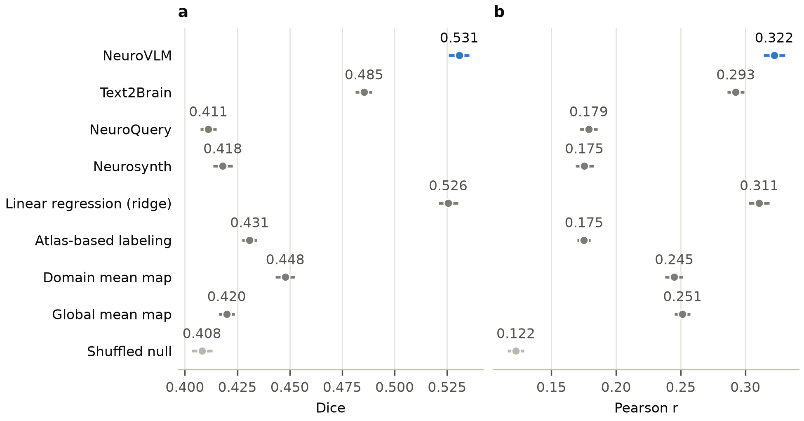
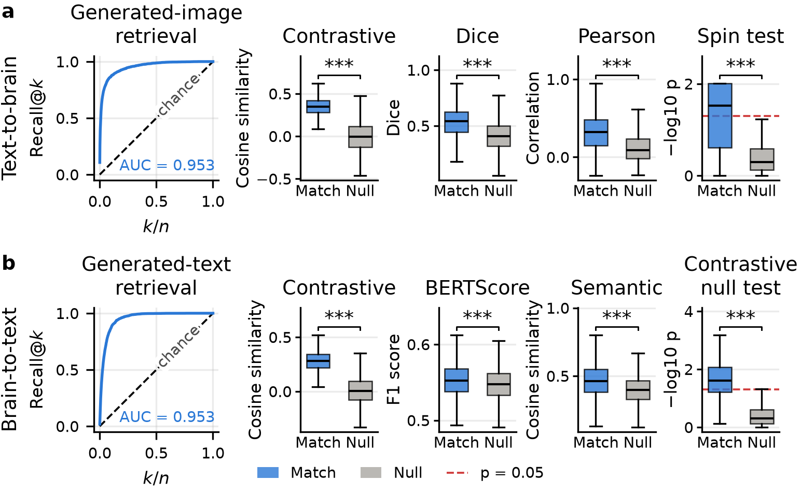
<!-- produced by core/a1_text_to_brain_baselines/make_figure.py (maps: run_text_to_brain.py; per-method numbers, the notebook head (Dice 0.492, not shown) and the nearest training paper by SPECTER2 (Dice 0.395): outputs/results_table_full.csv; domain rule, k-means k = 10 on training-map latents, and Harvard-Oxford term matches, 2,597 of 2,971 queries: README.md and outputs/run_config.json; final head (head v2) and its validation study: scripts/models/README.md, "Text-to-brain head v2"); retrieval table: core/a1_retrieval_metrics_table/make_figure.py (outputs/retrieval_metrics_table.tex; final contrastive heads: R@10 0.088 both ways, MRR 0.045 / 0.041, median rank 230 / 217; scripts/outputs/validation/final/report.md gives 0.044 and 216, the same heads within rank ties). Every method is scored against the autoencoder reconstruction of the paper map (run_text_to_brain.py, Dice of each map's voxels above its 70th percentile). NeuroVLM (linear head) = ridge: closed-form, SPECTER2 (768) -> autoencoder latent (384), alpha 0.3 chosen from {0.01, 0.1, 0.3, 1, 3, 10} by validation Dice (2,961 papers, one split, no CV); final head: ProjHead 768-512-384, latent MSE + decoded-map correlation losses, epoch chosen by validation Dice. Neurosynth / NeuroQuery used as published, no test-set exclusion (z53/facts.md section 4): 1,386 of the 2,971 test papers are Neurosynth v7 studies and 1,295 are in NeuroQuery's corpus (1,814 in either, 1,157 in neither). Text2Brain (z59): released weights (HF mirror neurovlm/text2brain-mirror) with two fixes for current libraries, same inputs and targets; Dice 0.485 [0.481, 0.489] / r 0.293 [0.286, 0.299], Holm p 7e-161 / 8e-34 against NeuroVLM; "at most 0.49" in the first paragraph = Text2Brain 0.485. Its training corpus is NeuroQuery's (1,295 of the test papers). On the 1,676 test papers outside it: NeuroVLM 0.525 / 0.300, ridge 0.521 / 0.288, Text2Brain 0.472 / 0.264. -->
<!-- z94: "Modest differences" and Fig. R2 (fig4_generative_metrics_text.json: paired_differences, BERTScore delta > 0 for 56.6 % of 2,971 maps, MiniLM 65.9 %, paired t p 3e-22 and 6e-108; text_score_reference: two random test papers BERTScore F1 0.579, a paper and its nearest test paper 0.623, a summary and its own abstract 0.684). "Random training texts score higher": Table R9 (0.580 against 0.553). z117: "Modest differences" replaced by the z114 answer 4 version (two random test papers 0.579 against a matched caption 0.553; contrastive cosine 0.28 against 0.01, paper Supplementary Table S4). -->
<!-- z61: expert-rating substitutes: anatomy / meaning = a6_steering_tokens (3.6), unsupported claims = a2 lexicon (3.3), specificity = a1_retrieval_metrics_table (hard negatives). Reason for not running ratings: the author's (OPEN_ITEMS: expert labor is costly; experts already labeled the networks; anatomical atlases for reference). 57 % = retrieved captions reporting other studies' details (3.3, a2). Raw-map scores (results_table_full.csv dice_top10_raw / pearson_raw; the author cut them in check5, z93 D8 restored one sentence in "Independent evaluation"): NeuroVLM 0.281 / 0.232, ridge 0.275 / 0.223, Neurosynth 0.235 / 0.148, NeuroQuery 0.228 / 0.141, nearest training paper 0.187 / 0.092, null 0.157 / 0.082 -->

<a id="1.2"></a>
### 1.2: Publication-level supervision and dataset separation
**Comment:** explain how coordinates are combined per paper, give final counts, confirm that held-out papers were kept out of the language-model corpus and the synthetic data, and add a data-flow diagram. \
Each map pools every coordinate of one paper. We answer the five points below, confirm the separation of datasets, and added the requested data-flow diagram (Fig. R3) and the final counts.

**1. Experiments and contrasts.** Yes. Each paper's map combines the coordinates of all its experiments and contrasts, because the released coordinates carry no experiment or contrast labels. Each map therefore matches the paper-level text it is paired with.

**2. Positive and negative effects.** Positive and negative effects are pooled, because the released coordinates carry no sign. Each map shows only where effects lie, not their direction. The Methods state this.

**3. Multiple coordinate tables.** All coordinate tables of a paper are pooled into one map. Among open-access papers with a coordinate table, 42% report two or more.

**4. Final counts.** The released data hold 30,826 publications. Experiments and contrasts cannot be counted, because the released coordinates carry no labels for them. Coordinate tables can be counted only in the open-access full texts, which exist for fewer than half the papers and hold 20,541 tables. The Methods give the splits, and Fig. R3 the data of each training stage.

**5. Contrast-level evaluation.** Yes, on NeuroVault, whose maps are released per contrast. We added a per-map evaluation in which each of a paper's maps is scored as its own target against the paper's text ([1.3](#1.3)). The model beats chance in both directions (AUC 0.62 and 0.63 against about 0.50).

**Separation of datasets.** Fig. R3 is the requested data-flow diagram. No validation or test paper trains the autoencoder, the projection heads, or the projectors. The validation, test, and NeuroVault evaluation papers are excluded from the language model's corpus by its training script. As a memorization check, the longest phrase a generated caption shares with its paper's abstract is two words at the median.

**Synthetic data and prototype bank.** The synthetic maps are built from training papers only (Reviewer 2, [2.4](#2.4)). The prototype bank holds short network, region, and function texts and no test document. Its network entries share names with the evaluation atlas networks, but no atlas map trains any component.
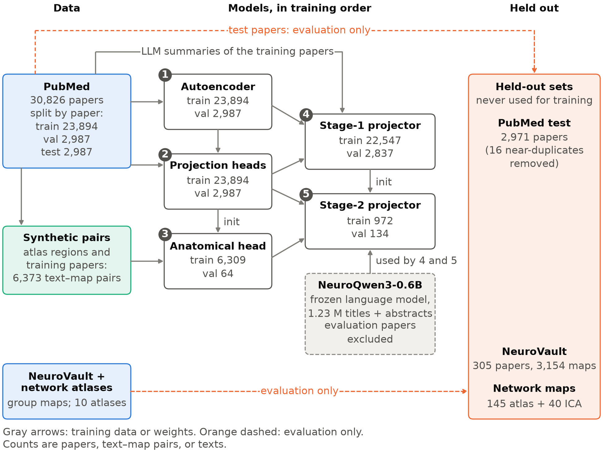


<!-- z94: coordinate tables = core/a4_caption_audit/outputs/coverage_summary.csv, row all (n_coord_tables 20,541, n_with_coord_table 11,943, pct_pubs_with_ge2_coord_tables 42.16). No network-atlas map trains any component: stage 11 builds its synthetic pairs from the AAL atlas and training-paper maps, stage 14 pairs texts with maps that the anatomical head generates, and stage 13 only logs probe captions of atlas maps (scripts/models/11, 13 --probe-every, 14). The data-flow box now says "evaluation papers excluded" (author, check7) and "145 atlas + 40 ICA". -->
<!-- produced by core/a4_dataflow_diagram/make_figure.py (counts: run_analysis.py); final counts (1.2, item 4): 30,826 publications, 20,541 coordinate tables in the 11,943 open-access papers with a coordinate table (core/a4_caption_audit/outputs/coverage_summary.csv; open access 12,204 of 30,826 papers); core/a4_counts_table/outputs/counts_table.md has 857,298 peaks, median 17 per paper. z117: Table R3 (final counts) removed at the author's request, its content in item 4, later tables renumbered (R4-R14 -> R3-R13); synthetic and canonical texts vs held-out papers, max MiniLM cosine 0.84: core/a4_leakage_audit/outputs/leakage_table.md. Pooling per paper: the released coordinates carry only PMID, DOI and peaks (core/a4_counts_table/outputs/counts_table.md). 0.62 / 0.50 = a3 per-map AUC (bounds_metrics.csv variant pos, per_image, both directions) -->
<!-- z61: language-model corpus (z53/facts.md section 2, z53/overlap.py): NeuroQwen3-0.6B was adapted on 1,231,613 PubMed neuroimaging titles and abstracts (1990 to 2026-02-26) with no PMID or DOI filter; 2,906 of the 2,971 evaluated test papers are in it (2,878 in its training portion, 28 in its validation portion), 97.8 %; the NeuroVLM training (23,314 / 23,894) and validation (2,910 / 2,987) papers too. NeuroVault overlap not measured ("not filtered for any held-out set" covers it). Memorization check (core/a4_memorization_check; z60 notes B): 2,971 test captions vs 2,971 training captions (seed 0), each against its own title + abstract: longest shared word run median 2 / 95th percentile 4 / max 8 (training 2 / 4 / 7, p = 0.21); one test caption shares an 8-gram (a list of region names); ROUGE-L 0.104 vs 0.105 (p = 0.39), another paper's abstract 0.099. Fig. R3's NeuroQwen box reads "1.23 M titles + abstracts" and its atlas box "145 labeled + 40 ICA" (a4_dataflow_diagram, fixed before z68). Projectors (stages 13, 14), heads, autoencoder and synthetic maps: training papers only (z45/z47 checks). Canonical bank = SPECTER2-side semantics of the stage-14 [NETWORK]/[REGION]/[FUNCTION] texts (scripts/models/14_qformer_anat.py, canonical_semantic_banks); the 185 atlas / ICA maps and NeuroVault maps are evaluation only. Neurosynth and NeuroQuery also pool all coordinates of an article and do not separate activations from deactivations -->
<!-- z72: author: "be proactive and write that the test set was excluded". 1.2, 2.2, 2.4 and 2.11 now say the training script removes the validation, test and NeuroVault evaluation papers from the continued-pretraining corpus. The shipped NeuroQwen3-0.6B (23f50c9) predates that filter (the overlap above); the author reruns scripts/models/00_neuroqwen_dapt.py, then stages 13-14, validation, the cascade and the two-run proof (OPEN_ITEMS.md). -->

<a id="1.3"></a>
### 1.3: NeuroVault evaluation
**Comment:** keep the model-selected image as an upper bound, add a target-independent evaluation, and treat and report map types separately. \
We kept the model-selected map as an upper bound and added two target-independent rules and a lower bound (Fig. R4). Multi-target retrieval counts any of a paper's maps as a hit. The per-map score makes each map its own target. The lower bound keeps each paper's worst-matching map. The model beats chance under every rule, and per-map retrieval reaches an area under the recall curve (AUC) of 0.62 from text to brain and 0.63 from brain to text.

**Map types.** No map-specific transformation was applied before thresholding in the submission, which thresholded every map alike after removing masks, parcellations, anatomical maps, and variance maps. P-maps are inverted to 1 − p, so that high values mark strong evidence. Signed maps keep their positive tail, as before, because using both tails, or adding negative tails as extra maps, reduces evaluation performance. Table R3 reports each map type separately, and Fig. 5b uses the same handling.
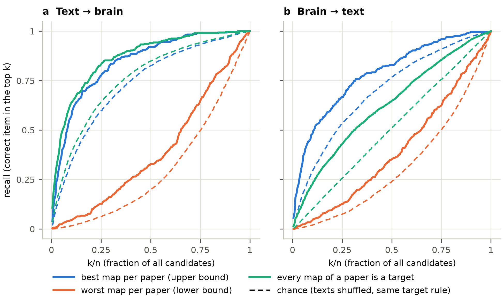

| Map type | Maps | Papers | Handling | text → brain | brain → text |
|---|---|---|---|---|---|
| T | 1,761 | 189 | positive tail | 0.64 | 0.64 |
| Z | 811 | 75 | positive tail | 0.57 | 0.58 |
| beta, univariate | 43 | 5 | positive tail | 0.61 | 0.77 |
| F | 40 | 17 | positive tail | 0.64 | 0.55 |
| beta, multivariate | 14 | 5 | positive tail | 0.84 | 0.83 |
| p | 3 | 2 | inverted (1 − p) | 0.64 | 0.60 |
| 1 − p | 2 | 1 | used as is | 0.54 | 0.44 |
| Other, t, z, or F | 204 | 23 | positive tail | 0.63 | 0.70 |
| Other, effect estimate | 103 | 15 | positive tail | 0.69 | 0.62 |
| Other, component or gradient | 93 | 8 | positive tail | 0.49 | 0.51 |

<!-- produced by core/a3_neurovault_bounds/make_figure.py (bounds: outputs/bounds_table.csv; per-type table: outputs/map_type_table.md; exclusion of masks and parcellations: outputs/counts_table.csv, stage C). Final model (runs/final), 298 papers / 3,074 maps after typing the maps labeled Other (--other-maps infer, z103; 70 mean or variance images and 10 untyped maps dropped, every AUC moves <= 0.0041, outputs/other_maps_options.csv; typing rules in _other_maps.py, agreement with the uploaders' own T/Z/F types 98.7 % on 1,775 declared maps): upper bound 0.847 (chance 0.738), lower bound 0.397 (0.306), multi-target 0.866 (0.759). Fig. 5b inverts its three p-maps (two papers) before the release threshold (z54 section 1: a3 variant released rebuilt, released_raw kept): text to brain 0.847, brain to text 0.787, changes of at most 0.002 (fig5_perf_quant_text.json). Components and gradients labeled Other sit at chance (0.49 / 0.51): their sign is arbitrary, and they are kept like the 179 declared Z maps that are ICA components. Table: outputs/bounds_table.tex. Dashed chance lines: every text is given to another paper (a derangement), then the same best / worst / any-map rule and ranking are applied; curves and AUCs are the mean of 20 derangements (run_analysis.py --n-null-draws 20; make_figure.py, plot docstring). x label "k/n (fraction of all candidates)" (z54) -->
<!-- z47 (check8 values, z103): per map = bounds_metrics.csv variant pos, per_image: text to brain 0.619 (chance 0.502), brain to text 0.626 (0.509); |value| 0.614, negative tails as extra maps (signsplit, 5,998 maps) 0.557; lift above chance under every rule and direction 0.081-0.117. Exclusion of parcellation / anatomical / ROI-mask / variance maps already in the data notebook 02_data/03 (outputs/counts_table.csv stage C); the submission's tensor clipped negatives and did not invert p-maps (variant released_raw, config.json) -->

<a id="1.4"></a>
### 1.4: Scope of the generative claims
**Comment:** describe outputs as coarse spatial priors, and add failure cases, out-of-distribution inputs and a confidence or abstention signal. \
We agree and adopted this framing. The Abstract, Results, and Discussion describe text-to-brain outputs as coarse spatial priors that carry no effect size, sign, or uncertainty, and brain-to-text outputs as broad network-level labels, not interpretations of a specific study or mechanism.

**Failure cases.** In 16% of the 2,971 PubMed test-set captions, the similarity to the paper's text is negative. Many of these failures start in the data, where the paper's own text and map are already among the least similar pairs of the test set. The rest are model misses. Our response to Reviewer 2 analyzes them ([2.12](#2.12)).

**Out-of-distribution inputs.** Warning scores flag inputs far from the training data (Fig. R5). A map is flagged when it correlates poorly with its autoencoder reconstruction or when its latent lies far from the training latents, and a text when it lies far from every training abstract. With thresholds set on the validation split, the scores flag about 5% of PubMed test-set maps and abstracts, every shuffled, white-noise, and rescaled map, every off-topic text, and 61 to 80% of rotated or spun maps.

**Abstention and confidence.** Flagged inputs can be withheld, but the warning scores are not calibrated probabilities. Within the training distribution, the peak of a calibrated text-to-brain map serves as a confidence score, because it tracks the map's retrieval rank (Spearman 0.63). The peak does not detect off-topic text, whose maps mostly peak within the range of the test abstracts.
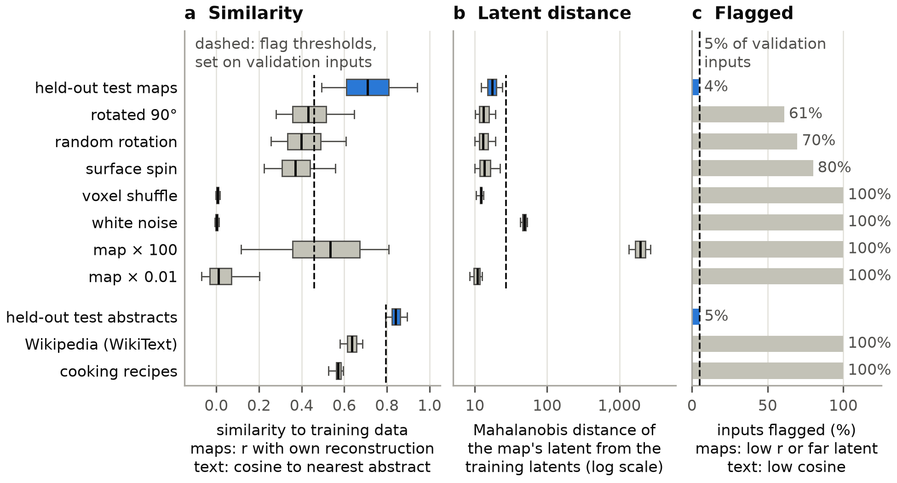
<!-- produced by core/a7_ood_confidence/make_figure.py (outputs/flagged.csv; thresholds on the validation split, 2,961 maps / abstracts: map r(map, reconstruction) < 0.46 (2.5th pct) or latent Mahalanobis > 27.0 (97.5th pct), text SPECTER2 cosine to nearest training abstract < 0.79 (5th pct). Flagged: validation maps 5.0 %, test maps 4.5 %, rot90 / rotation / spin 61 / 70 / 80 %, shuffle, noise, x100, x0.01 100 %; test abstracts 5.2 %, WikiText and recipes 100 %; AUROC 0.89 to 1.00. The previous plain cosine missed white noise (0 %): a dense non-negative map and its flat reconstruction share a constant component, cosine 0.63 against a 0.55 threshold, r 0.00 (outputs/diagnosis.csv). Single scores at the validation 95th percentile: outputs/detection.csv. 16 % = test-set captions with a negative similarity to the paper's text (2.12, a7_failure_cases_percentiles)) -->

<a id="1.5"></a>
### 1.5: Inconsistent dataset and metric values
**Comment:** 3,000 or 4,553 NeuroVault maps, 100 or 300 network images, and AUROC 0.94 or 0.975. \
We recomputed every count from the released data and corrected the text and captions.

**NeuroVault maps.** The Methods' 3,000 was a rounded count, and the supplement's 4,553 maps predate image quality control and the removal of papers already in PubMed. After these steps, the leakage audit, and the removal of mean, variance, and untyped maps, retrieval uses 3,074 maps.

**Network images.** We corrected both counts to the 185 released network maps. They are the atlas maps and the ICA components.

**Autoencoder AUROC.** Both values were correct but referred to different datasets, the caption's 0.94 to NeuroVault and the main text's 0.975 to the PubMed test set. With the final model, the Fig. 5 caption and the main text give 0.939 on NeuroVault and 0.974 on the PubMed test set, and each names its dataset.
<!-- z115: Table R5 (corrected counts and AUROCs) removed at the author's request, its content now in the text above and in 2.7; later tables renumbered (R6 -> R5 ... R15 -> R14). The table rows were: NeuroVault 3,183 released maps from 312 papers, 3,154 from 305 after the leakage audit, 3,074 from 298 for retrieval; 185 network maps = 145 atlas maps (119 with a network label) + 40 ICA components; AUROC 0.94 on NeuroVault and 0.975 on the PubMed test set (submission), 0.939 and 0.974 with the final model (paper Fig. 5 caption). -->

<!-- produced by core/a4_counts_table/make_figure.py; AUROCs: scripts/outputs/validation/final/report.md (ae) and ../main/fig5_perf_quant_text.json (panel c) -->
<!-- z47: 4,553 ~ the metadata-eligible set at scrape time (core/a3_neurovault_bounds/outputs/counts_table.csv stage C', 4,614 today), before image QC (E) and before dropping collections whose DOI is in the PubMed corpus (F); 3,183 = released (G); 3,154 / 305 after the leakage audit (I). 26 of the 145 atlas maps carry no network label. The 2.7 copy of this table (Reviewer 2) should match these rows -->

<a id="1.6"></a>
### 1.6: SPECTER and SPECTER2
**Comment:** SPECTER and SPECTER2 are used inconsistently. \
Every text-encoding step uses SPECTER2, the allenai/specter2_aug2023refresh model with its ad hoc query adapter. The original SPECTER is never used. We corrected every mention to SPECTER2.
<!-- no script: text change only -->

<a id="1.7"></a>
### 1.7: Two methodological analogies
**Comment:** transformers also use a fixed tokenizer vocabulary, and a projection head is not LoRA. \
We agree with both points. The tokenizer sentence states that contextual encoders also depend on a fixed vocabulary and that their advantage is composing words in context. The LoRA analogy is deleted, and the head is named the text-to-brain head. Two analyses for Reviewer 3 test the composition claim. SPECTER2 beats a context-free word2vec encoder ([3.4](#3.4)), and swapping one word moves the generated map as expected, although negation has no effect ([3.5](#3.5)).
<!-- no script: text change only -->

<a id="1.8"></a>
### 1.8: Edge-device claim
**Comment:** report memory, latency, hardware, precision and quantization for the full pipeline. \
Table R4 reports memory, latency, hardware, and numerical precision for both full pipelines, projector and language model included, on a consumer GPU and a desktop CPU. On the CPU, dynamic int8 quantization runs brain-to-text fastest but saves no memory over bf16. We tested no phone or embedded device, so the Methods claim a consumer CPU instead of edge devices. The timings use the released weights, whose projector and text-to-brain head have the same size as the final ones.

| Pipeline, one query | Parameters | GPU, bf16 | CPU, fp32 | CPU, bf16 | CPU, int8 |
|---|---|---|---|---|---|
| text-to-brain | 171 M | 7 ms, 0.4 GB | 135 ms, 0.6 GB | 53 ms, 0.4 GB | 120 ms, 0.5 GB |
| brain-to-text, 128 tokens | 685 M | 3.2 s, 1.3 GB | 13.1 s, 2.7 GB | 6.3 s, 1.4 GB | 3.5 s, 1.4 GB |

<!-- produced by core/a8_edge_benchmark/make_figure.py from outputs/results.csv (measurements: run_analysis.py, idle RTX 5090 and 8 CPU threads; GPU rows 2026-10-09, CPU rows rerun 2026-10-13). Latency: median of 5 timed calls after a warm-up (GPU text-to-brain: 20). Memory = the peak the pipeline adds (weights and activations) during the batch-1 calls, after loading (GPU: max allocated; CPU: max RSS minus the 0.84 GB pre-load RSS of Python, PyTorch, transformers, adapters and the inputs, libraries pre-imported, heap trimmed before every peak reset; check8, z102: CPU and GPU now agree, text-to-brain bf16 376 / 376 MB, brain-to-text bf16 1426 / 1364 MB); int8 = dynamic quantization of every nn.Linear, measured after the fp32 model it was quantized from is released (quantize_dynamic returns a copy). Brain-to-text CPU: int8 3.5 s / 1.41 GB, bf16 6.3 s / 1.39 GB, fp32 13.1 s / 2.7 GB (int8 fastest, bf16 and int8 tie on memory); text-to-brain: bf16 fastest and smallest. Why int8 is not smaller (z102): quantize_dynamic converts only nn.Linear, so NeuroQwen3's 156 M-parameter token embedding stays fp32 (0.58 GB) and the output layer, tied to it in bf16, gets its own int8 copy (0.14 GB), weights 1.26 GB int8 against 1.28 GB bf16; SPECTER2's adapter library wraps 60 of its 97 linear layers in LoRALinearTorch, which quantize_dynamic skips (forcing them to int8 drops the map r to fp32 to 0.97, min 0.93, so they are left as shipped). The old int8 cells also carried a 0.56 GB bug (state_dict() after the heap trim unpacked every int8 weight), and weights_mb counted tied tensors twice; both fixed. Load-time peaks 5.4 / 2.0 / 6.5 GB (outputs/results.csv cpu_load_peak_rss_mb). The benchmark loads the released weights, including the notebook text-to-brain head (same ProjHead 768-512-384 as the final head) and the released Q-Former (28.8 M against the MLP's 28.6 M, a8 README); brain-to-text is greedy, forced to 128 tokens (z45/facts_C.md) -->

<a id="1.9"></a>
### 1.9: Figure text size, full descriptions, affiliations
**Comment:** text in Figs. 2, 3 and S4 is too small. Give the full generated descriptions and fix the "Organization" placeholders. \
We redrew Figs. 2, 3, and S4 at the journal's text width with larger text (Figs. R6 to R8). New Supplementary Table S5 gives the complete generated texts of Fig. 2, and Figs. 3 and S4 print each generated text in full beside its map. The affiliation placeholders are corrected.
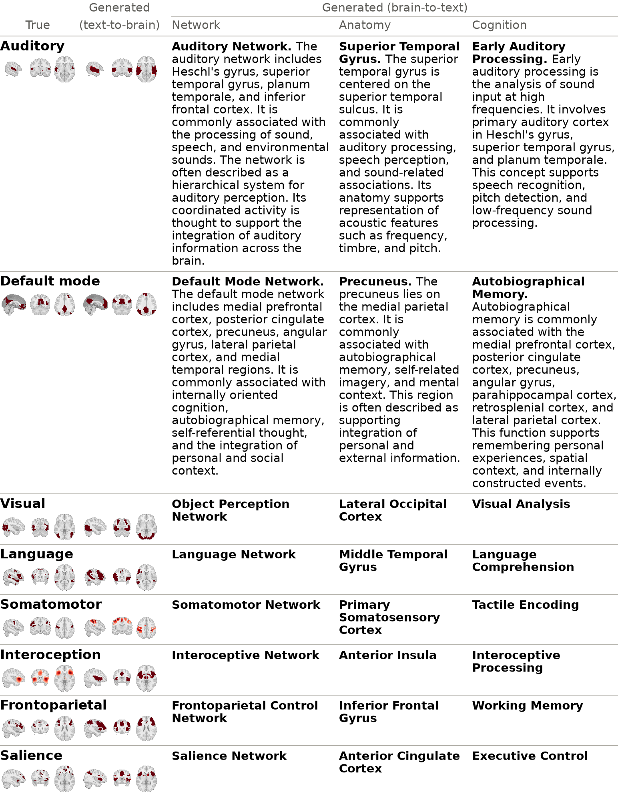
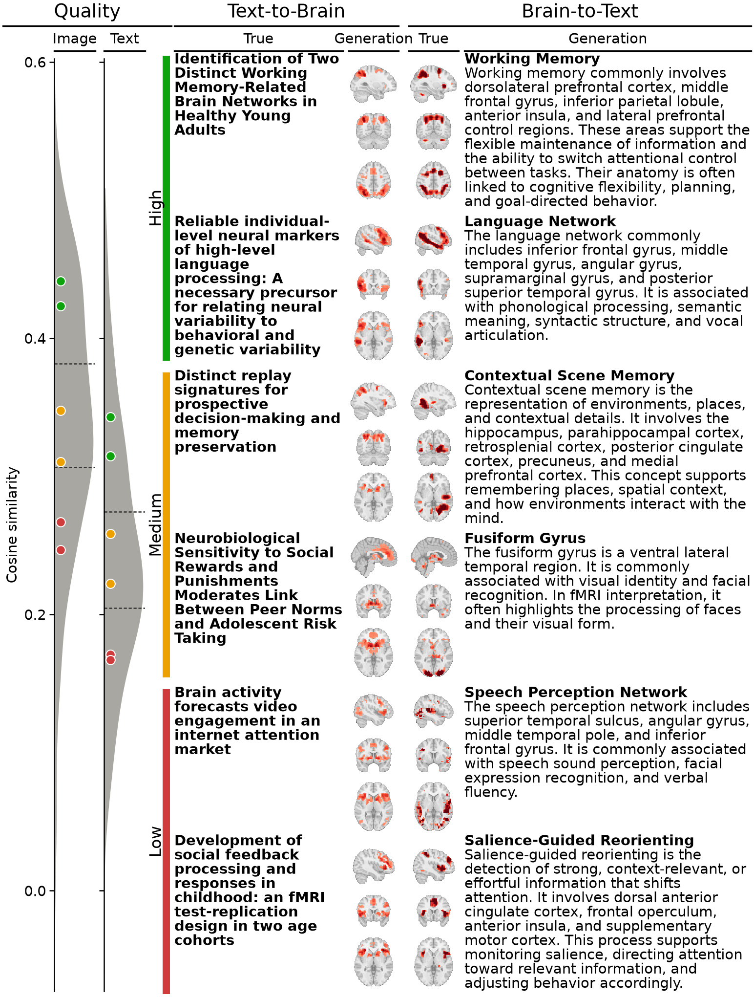
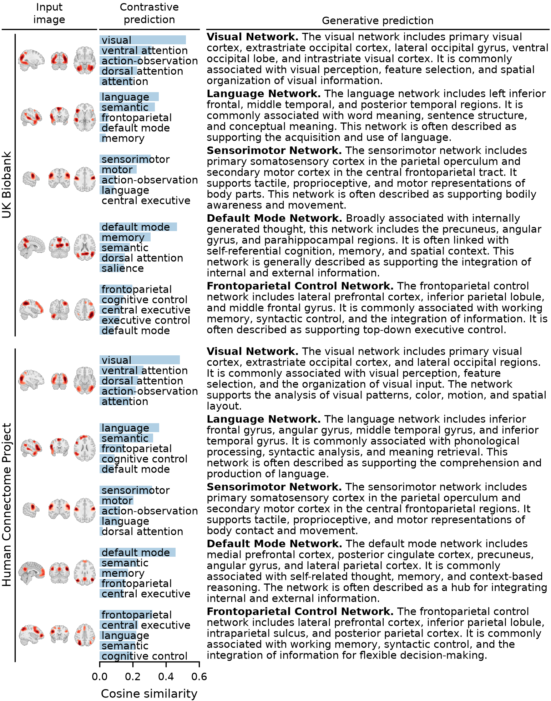
<!-- produced by ../main/make_all.py (final model; Fig. 2 titles and caption fixes in ../main/README.md). Fig. 2 is one page; its complete texts are ../main/fig2_texts_table.{tex,md} (written by fig2_network_examples.py; --text-pages restores the old pages 2-4), Supplementary Table S5 if appended after the paper's four supplementary tables (z57 section 4). Counting rule (strict): a title is exact only if it names the reference network itself, so "Object Perception Network" for the visual map (YeoLab VisualA) counts as the right system only. 7 of 8 exact network names (the somatomotor map is titled "Somatomotor Network" since the canonical-title decoding, z65), 8 of 8 right system. Stage 14 was retrained with a changed recipe (scripts/models/README.md, "Salience (Fig. 2)"): all five seeds title the Du SAL/PMN map "Salience Network" -->
<!-- z47: Fig. 4 caption said p < 1e-100 for all panels; BERTScore is p = 9e-19, Cohen's d 0.23 (matched 0.553 vs null 0.548; MiniLM 0.463 vs 0.397, p = 1e-109; calibrated maps, canonical titles, scripts/figures/main/fig4_generative_metrics_text.json of 2026-10-13). Fig. 5 caption AUC fix: 2.8. Both are listed in the 1.9 changes line only (z61: cut from the response text as beyond the request). z84 (check6, z82): the submitted Table S4 null (0.52) was a cached null_bert_f1_seed0.pt from an earlier generation run of notebook 24 (dated 17:12, captions regenerated 20:03); the submitted captions against their proper shuffled references give 0.5567 vs 0.5538 on 400 items, so the gap was about 0.005 then too; one sentence in 1.1 and one in Supplementary S6 -->

<a id="1.10"></a>
### 1.10: Overall assessment
**Comment:** a creative and useful framework that needs independent validation of the generated outputs, clearer dataset separation, a revised NeuroVault evaluation, and more precise framing of the generated maps. \
The four revisions named here are made in our responses to [1.1](#1.1) to [1.4](#1.4), in the same order.

<a id="1.11"></a>
### 1.11: Code availability
**Comment:** fix the merge conflicts, remove manual steps and machine-specific paths, pin dependencies and Hugging Face artifacts, and add a figure-by-figure guide. Coverage was 47%. \
The results reproduce end to end. One command builds the pinned environment, fetches the Hugging Face inputs at pinned and checksummed revisions, retrains every model, redraws the figures, and checks each metric against the paper. No step is manual and no path is machine-specific. Two runs from scratch gave byte-identical weights on the same GPU model and library versions. We resolved the merge conflicts in both notebooks and added a figure-by-figure guide that names the script behind every paper figure.

**Tests and coverage.** Coverage is [author: new percentage] on the 58 files that train the models and draw the figures. The CNN and other experiments outside the paper are excluded from the measure. Because training takes hours, continuous integration trains every model for one batch on CPU, which exercises the whole pipeline.

**Remaining limits.** Two inputs remain outside the pinned set, the Automated Anatomical Labeling (AAL) atlas, whose download server fails, and the NiCLIP and NeuroConText outputs compared in Fig. S3. [author: one clause on how each is obtained, e.g. "both ship with the repository" or "both are fetched from their authors' releases".]
<!-- produced by scripts/pipeline/reproduce.sh and scripts/pipeline/verify_reproduction.py (scripts/README.md "Reproduce", "Determinism and proof"). Inputs: scripts/config/hf_manifest.json (pinned revisions and sha256, fetched by scripts/data/fetch_hf.py); determinism: scripts/pipeline/common.py setup_torch, PYTHONHASHSEED=0; end-to-end check: scripts/README.md "Determinism and proof" (two full reproduce.sh runs, each from a fresh tree, .venv and empty --home: all 97 model and data files, both generated-text files and all 9 figure PNGs byte-identical (previous layouts; the figures redrawn on 2026-10-12 at the template widths were byte-identical across two CPU renders, scripts/README.md "Determinism and proof", rows g and h); validation metrics identical except four BERTScore values, delta <= 6e-7 from Python's hash seed, now fixed and checked; verify_reproduction.py 8/8 exact against the rebuilt reference). Bitwise identity holds only on the same GPU architecture with the same driver and library versions. Environment: scripts/config/requirements.lock, scripts/config/Dockerfile; smoke: scripts/pipeline/smoke_pipeline.sh and tests/notebooks. CI: .github/workflows/smoke.yml runs train_pipeline.py --smoke --no-validate --device cpu on push and pull request (stages 08, 09, 20 fold 0, 11, 12, 13, 14; one epoch of one batch on 64 samples, scripts/pipeline/common.py SmokeCaps.max_batches = 1; z62 CPU run: all seven stages exit 0 in 5 min), under coverage run; tests.yml runs pytest --cov. Coverage scope: .coveragerc ([report] include: fetch_hf.py, the training stages 08, 09, 11-14, 20 and their helpers, train_pipeline.py, validate_models.py, verify_reproduction.py, scripts/figures/main, and the library modules they import: 58 files reported, 26 scripts + 32 library modules (z111 smoke run of 2026-10-14 at the new paths, reproduction-code coverage 36.6 %); [run] omit: the CNN, atlas-free data, notebook-era trainers and evaluators, runtime and retrieval API, data stages 01-07, review analyses). The new coverage percentage is not recorded here (first GitHub run pending, OPEN_ITEMS). Generation recipe: greedy or beam decoding with the vocabulary restricted to Latin-script tokens; captions repeat bit for bit only at the same generation batch (validation and Fig. 4: batch 128) -->
<!-- z47: figure guide = scripts/figures/main/README.md (figure -> script -> outputs -> models table) and scripts/README.md; external inputs = scripts/README.md 'Known limits' (AAL via --external-dir; Fig. S3 baselines via --external-root) -->

## Reviewer 2

<a id="2.0"></a>
### 2.0: General remarks
**Comment:** a meaningful topic with a potentially valuable dataset, but not suitable for publication in its current form. \
We addressed each issue ([2.1](#2.1) to [2.12](#2.12)).

<a id="2.1"></a>
### 2.1: Motivation of the Qformer
**Comment:** the motivation for the Qformer is unclear. Compare it with simpler alternatives, such as an MLP projector or cross-attention. \
We agree. The Qformer attended over only two input tokens, the map latent and its semantic vector, so its attention had little to select. We compared it with a multilayer perceptron (MLP) projector of the same size, which raises stage 1 retrieval AUC from 0.82 to 0.90 (Fig. R9). The MLP projector replaces the Qformer in both stages. A cross-attention module would also attend over only two tokens, so we did not test one.
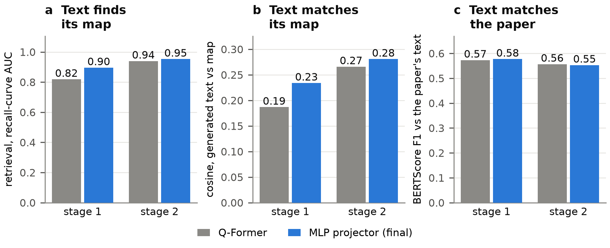
<!-- produced by core/a5_mlp_projector/make_figure.py (variant study: run_analysis.py). Bars: validation/released_excl (original model, Q-Former) vs validation/final (MLP projector): recall AUC stage 1 0.819 -> 0.896, stage 2 0.940 -> 0.953; shared-space cosine stage 1 0.19 -> 0.23, stage 2 0.27 -> 0.28; BERTScore stage 1 0.57 -> 0.58, stage 2 0.557 -> 0.553; final model with the retrained stage 14 and Latin-script decoding (the original model's captions, validation/released_excl of 2026-10-07, and the variant study were not regenerated). "0.82 to 0.90" holds for both the figure (whole models) and the same-input variant study on the released model's latents, language model and data: Q-Former 0.819 vs the parameter-matched MLP-M 0.905, 28.5 M vs 28.3 M parameters (outputs/results_summary.md); retrained by the same script on the proof run's inputs: Q-Former 0.860 vs MLP 0.907 (scripts/models/README.md 'Projector choice'). Cross-attention layers inside the language model were not tried: the projector sees two input tokens (map latent and semantic vector), and the Q-Former already cross-attends to them. The figure legend still reads "Q-Former (submitted)" and "MLP projector (adopted)"; the letter text says Qformer, as the paper does. -->

<a id="2.2"></a>
### 2.2: Datasets and sample sizes per model
**Comment:** give the datasets and sample sizes of each model, and say whether image-text pairs are reused across training stages. \
Fig. R3 and Table R5 give the data and sample size of each training stage, and several stages reuse the same training papers. Reviewer 1 raised the same concern ([1.2](#1.2)).

**1. Datasets and sample sizes.** Table R5 lists the training and validation size of each component, and Fig. R3 shows which set feeds each stage.

**2. Reuse across stages.** Yes. The same training papers and their maps train the autoencoder, the contrastive projection heads, and the stage 1 projector. The anatomically centered head and the stage 2 projector train on short concept texts paired with maps built from training papers only ([2.6](#2.6)). No validation or test paper trains any component, and the language model's training script removes them from its corpus ([2.11](#2.11)).
<!-- per-stage table (Table R5): core/a4_counts_table/outputs/stage_splits.md (written by core/a4_counts_table from scripts/outputs/runs/final/*.summary.json: stage 2 projector 972 / 134 texts, 1,106 of 1,338 kept; anatomically centered head 6,309 / 64 pairs), the same numbers as the diagram. NeuroQwen3-0.6B row from z53 (01_dapt.ipynb, 05_dapt_pubmed_neuroimaging.ipynb): 1,231,613 records, random 1 % validation split (seed 12345), 1,219,296 train / 12,317 validation; stage_splits.md still says 1,200,000 / 0 and should be updated. Corpus overlap with the test set: 2,906 of the 2,971 evaluated test papers (z53/overlap.py; 2.11). The concept texts are not all LLM-written (2.6), hence "short concept texts". -->

<a id="2.3"></a>
### 2.3: NeuroVault selection bias
**Comment:** when a paper has several NeuroVault images, the model picks the most similar one, which may inflate the results. \
We agree that choosing the most similar map inflates the score. A lower bound keeps each paper's worst-matching map, a multi-target score counts any of the paper's maps as a hit, and a per-map score makes each map its own target (Fig. R4). Each rule has its own chance curve, from texts shuffled across papers, and the model's AUC stays about 0.1 above chance under every rule. Reviewer 1 raised the same concern ([1.3](#1.3)).
<!-- produced by core/a3_neurovault_bounds/make_figure.py -->
<!-- z47 (check8 values, z103): lift above chance (bounds_metrics.csv, variant pos): text to brain upper 0.847 - 0.738, lower 0.397 - 0.306, multi-target 0.866 - 0.759, per map 0.619 - 0.502; brain to text 0.787 - 0.698, 0.400 - 0.318, 0.626 - 0.509: 0.081 to 0.117. z61: the caption is the shared \capbounds macro (Reviewer 1 pass), repeated from Fig. R4 -->

<a id="2.4"></a>
### 2.4: Data leakage
**Comment:** DOI filtering may miss duplicate records, preprint and journal versions, and repeated coordinate tables. \
We audited leakage beyond DOI filtering with the checks below, which cover duplicate records, preprint and journal versions, and repeated coordinate tables. No DOI or PubMed identifier is shared across splits. The checks flag 16 test and 26 validation papers (Table R6), and every evaluation leaves them out. Seven NeuroVault papers that duplicate a training paper were also removed.

**1. Duplicate records and preprint versions.** Each held-out paper was compared with every training and NeuroVault paper by fuzzy title matching and by the similarity of its title and abstract. A preprint and its journal version share a near-identical title and abstract, so this check catches them.

**2. Repeated coordinate tables.** The coordinate tables from PubMed and Neurosynth Compose were compared across all splits. Identical or near-identical tables mark a paper that repeats another paper's peaks.

| Check against other papers | PubMed test set (2,987) | PubMed validation set (2,987) |
|---|---|---|
| Near-identical title | 4 | 6 |
| Near-identical title and abstract | 3 | 6 |
| Identical coordinate table | 6 | 12 |
| Near-identical coordinate table | 12 | 21 |
| Removed from every evaluation | 16 | 26 |

<!-- produced by core/a4_leakage_audit/make_figure.py (table = outputs/leakage_table.md). Checks (a4 README): DOI and PMID; fuzzy title, token-set ratio >= 95 and token-sort ratio >= 90; title + abstract MiniLM cosine >= 0.95; coordinate tables identical (rounded) or Jaccard >= 0.8 with >= 5 peaks. Title and title+abstract checks compare held-out papers with training and NeuroVault papers only (not with the other held-out split); the coordinate checks cover every other split. Rows overlap; the last is their union (removal_list.csv). The 7 NeuroVault papers (29 maps) match a training paper by title (7) and title+abstract (6) (summary.json f_neurovault_vs_train). Preprints: one NeuroVault collection carries a preprint DOI, none of which is in PubMed. "Kept only papers with no near-duplicate" = evaluations read scripts/eval_exclusions (author's check5: "kept only sufficiently unique examples"). At most 0.003: scripts/pipeline/validate_models.py --run scripts/outputs/runs/final --no-exclusions --name final_noexcl vs validation/final (GPU rerun with Latin-script decoding, 2026-10-12: AUC / Dice / r differences <= 0.0022, largest NeuroVault t2i AUC 0.8460 vs 0.8482; NeuroVault recall@10 0.0073; brain-to-text metrics <= 0.0005); split-leak fix and at most 0.003: scripts/models/README.md, "Stage 11 split leak (fixed)" (anatomical head on --splits all vs train maps, before head v2). Language-model corpus: 2,906 of the 2,971 evaluated test papers (98 %) are in the NeuroQwen3-0.6B DAPT corpus, 2,878 of them in its training portion (z53/overlap.py); the memorization check is reported in 1.2. -->

<a id="2.5"></a>
### 2.5: Competitive baselines
**Comment:** the generative tasks lack competitive baselines. Compare with existing methods and with simpler projection or retrieval baselines. \
NeuroVLM matches or beats existing approaches and simpler projection and retrieval baselines in both directions. Reviewer 1 raised the same concern, and the analyses are in our response to [1.1](#1.1).

**Text to brain.** Fig. R1 and Table R1 compare NeuroVLM's maps with three published models and four simple baselines. The projection baseline is the same model with a linear head, and the retrieval baseline is the nearest training paper's map. NeuroVLM leads both, as well as Neurosynth, NeuroQuery, the mean and domain maps, and atlas labeling. Text2Brain comes closest among the published models (Dice 0.49 against 0.53) and trails by more on the papers outside its own training corpus.

**Brain to text.** We know of no published model that writes text from group-level brain maps. The existing decoders NiCLIP and NeuroConText rank a fixed set of texts, and NeuroVLM is slightly ahead of both at that task (Fig. S3). The simpler projection baseline, an MLP projector, beats the Qformer and replaces it ([2.1](#2.1)). The retrieval baseline, the nearest training caption, is no closer to the paper's text than the generated caption and often carries another study's details (Reviewer 3, [3.3](#3.3)).
<!-- produced by core/a1_text_to_brain_baselines/make_figure.py; Table R1 = the 1.1 table (core/a1_text_to_brain_baselines/outputs/results_table_full.csv): NeuroVLM (non-linear head) Dice 0.531, NeuroVLM (linear head, ridge) 0.526, domain mean map 0.448, atlas labeling 0.431, global mean map 0.420, Neurosynth 0.418, NeuroQuery 0.411, nearest training paper 0.395, Text2Brain 0.485 (r 0.293). -->
<!-- z62: Text2Brain (author: "Add text2brain as a baseline"; z59) trails NeuroVLM, Dice 0.485 against 0.531. Its lead over Text2Brain is +0.046 on all test papers, +0.053 on the 1,676 papers outside NeuroQuery's corpus (Text2Brain's training pool) and +0.035 on the 1,295 inside it. Brain-to-text retrieval baseline and the 57 % of retrieved captions with another study's details: 3.3 (a2 table.csv). -->

<a id="2.6"></a>
### 2.6: Summarized and synthetic text
**Comment:** describe how the summarized and synthetic texts were generated, and give representative examples. \
One prompt generated the paper summaries and another generated the synthetic and curated texts. Both prompts are given below, and Table R7 gives a complete example of each kind of text.

**Summaries.** Qwen3.5-27B summarized each paper with the first prompt as its system message and the paper's title and abstract, joined by a separator token, as the user message. The prompt asks for a summary of the paper without its study details. Decoding used sampling with temperature 0.3 and top-p 0.9. Re-running the prompt on PubMed test-set papers gives summaries on the same topics as the released ones. The stage 1 projector learns from these summaries.

**Synthetic texts.** Qwen3.5-27B wrote short entries with the second prompt, from one seed per request, such as "Insula". The seeds were region names from standard brain atlases, Cognitive Atlas concepts, and the network names of our network atlases. Decoding used temperature 0.1 and top-p 0.9 with thinking mode off, and each seed was sampled several times to obtain re-wordings of one concept. The anatomically centered head learns from these entries, paired with maps built from training papers ([2.4](#2.4)).

**Curated texts.** The stage 2 projector learns from 1,106 curated texts about networks, regions, and functions. We generated them with Qwen3.5-27B in the same way. A script in the code repository repeats the process, and its texts match the released texts of the same seeds in content (MiniLM cosine 0.88 on average).
<!-- z97 re-creation scripts: scripts/data/08_synthetic_texts.py (author facts: the curated texts and the synth.parquet rows came from the synthetic-text prompt, Qwen3.5-27B through the HF router with sampling for re-wordings, seeds = nilearn atlas region names (the script uses AAL SPM12 as in stage 11, and Harvard-Oxford), Cognitive Atlas terms (pinned cogatlas.parquet) and the `networks` dataset names; original code not kept). Proof run 2026-10-13 (--limit 6 --n-per-seed 2, temperature 0.1): MiniLM cosine to the released text of the same seed 0.84 to 0.92, mean 0.88 (12 texts), against a median 0.48 to all 2,381 released texts (scripts/data/examples/synthetic_texts_examples.md). Note: z61 had found 582 synth.parquet rows (291 distinct) that look template-filled (Codex session 2026-05-04); the author's fact supersedes that reading. scripts/data/09_summaries.py: summary prompt + Qwen/Qwen3.5-27B through the router, thinking off, temperature 0.3, top_p 0.9, top_k 50, 256 tokens, 6 test-set papers (2026-10-14): one paragraph each, 143-175 words, finish reason stop, MiniLM cosine 0.88 on average to the released neuro_summaries.parquet text of the same paper (0.39 to other papers), 0.79 to pubmed_summary_qa (scripts/data/examples/summaries_examples.md; the earlier Llama-3.3-70B-Instruct proof gave 0.91 / 0.83). -->

```
Model: Qwen/Qwen3.5-27B
Decoding: sampling, temperature 0.3, top-p 0.9, top-k 50, at most 256 new tokens
User message: title[SEP]abstract
System message:

You are writing a short, topic-focused neuroscience mini-review.

INPUT:
You will receive:
    title + " [SEP] " + abstract from an fMRI publication.

GOAL:
Write a single coherent paragraph (4–6 sentences) that:
- Describes the scientific topic implied by the paper (e.g., meditation and the default mode
  network, exercise and working memory), not the paper’s methods.
- Explains the key cognitive processes (e.g., working memory, self-referential thought,
  emotion regulation) and the main brain systems or networks involved.
- May mention typical effects or relationships in general terms (e.g., “has been associated
  with changes in connectivity” or “can influence executive control”), but should stay high-level.

ALLOWED:
- General statements about effects or relationships (e.g., “exercise has been associated
  with improved cognition”, “meditation can alter DMN connectivity”).
- Generic references to “studies” or “research” in the field.
- Qualitative descriptions of brain activity or connectivity (e.g., “increased activation
  in prefrontal regions”, “changes in functional connectivity”).

AVOID:
- Exact numerical details (sample sizes, p-values, coordinates, time points).
- Detailed task or protocol descriptions from the specific study.
- Directly quoting or closely paraphrasing long sentences from the abstract.
- Overly narrow focus on this single experiment; write as if summarizing the topic area.

STYLE:
- Neutral, scientific tone, like a short review or encyclopedia entry.
- One paragraph only. No bullet points or headings.
- Focus on giving a clear sense of “what this topic is about” in the context of the field.
```

```
Write a short educational neuroscience entry for the provided fMRI concept.

Requirements:
- Explain the concept in general neuroscience terms.
- Always include relevant anatomical regions.
- Connect the anatomy to the cognitive or neural function.
- Use cautious, broad language; avoid overclaiming.
- Do not mention studies, patients, diseases, disorders, treatments, age groups, tasks, results, methods, or statistics.
- Do not use: critical for, responsible for, causal, proven, this study, activation, altered, reduced, increased.
- Do not invent highly specific subregions unless they are commonly associated with the concept.
- If the concept is broad, name the main commonly associated regions or networks.
- If the concept is anatomical, describe its broader network/function associations.
- Write 3-5 complete sentences.

Return valid JSON only:
{
  "title": "1-5 words",
  "description": "3-5 sentences"
}
```

| Text (used by) | Complete example |
|---|---|
| Summary of a training paper (stage 1 projector) | Theory of Mind (ToM) and empathy are crucial processes in social cognition, enabling individuals to attribute mental states and infer emotional experiences in others. These processes involve a network of brain regions, including the medial prefrontal cortex, superior temporal sulcus, and temporal pole. ToM and empathy share overlapping but distinct neuronal networks, with common areas of activation including the medial prefrontal cortex and temporoparietal junction. |
| Synthetic text "Insula" (anatomically centered head) | The insula is a deep cortical region situated within the lateral sulcus of the cerebral hemisphere. This area maintains connections with structures such as the anterior cingulate cortex and the amygdala. Processes occurring in this region are often linked to perceptions of internal bodily states and emotional awareness. It contributes to the integration of sensory information with subjective experience across various brain networks. |
| Curated [NETWORK] text "Salience Network" (stage 2 projector) | The salience network commonly includes anterior insula and dorsal anterior cingulate cortex. It is associated with detecting and prioritizing behaviorally relevant internal and external information. Its connections with limbic, autonomic, and frontoparietal systems support flexible shifts between internal monitoring and externally oriented control. |
| Curated [FUNCTION] text "Language Comprehension" (stage 2 projector) | Language comprehension commonly involves superior temporal cortex, middle temporal cortex, inferior frontal cortex, angular gyrus, and anterior temporal cortex. These regions support speech and text meaning, syntactic structure, and semantic integration. Left-hemisphere regions are often prominent, although bilateral temporal systems can contribute to broader language understanding. |
<!-- z61 facts. Summaries: HF dataset neurovlm/pubmed_summary_qa (pinned 2d53307; 29,146 rows); its dataset card says "generated with Llama-3.3-70B-Instruct. The LLM was instructed to: 1. Summarize each abstract, removing low-level study details. 2. Create ~90,000 question-answer pairs" (the QA pairs are not used). The prompt, endpoint and decoding settings are not on this machine: AUTHOR supplies the prompt for the first block ([AUTHOR: summary prompt]). The earlier claim (Llama-3.1-8B-Instruct, "topic-level paragraph" prompt of docs/01_data/07_transform_text.ipynb) was wrong: that prompt's outputs match 0 of 1,068 published summaries. Synthetic texts: prompt verbatim from docs/01_data/07_transform_text_gen.ipynb cell 8 (an earlier checkout) (system message; user message = the bare concept, cell 8 build_messages), model "Qwen/Qwen3.5-27B:cheapest" through the Hugging Face Inference Providers router (router.huggingface.co/v1, cell 7), temperature 0.1, top_p 0.9, max_tokens 512, enable_thinking False, JSON reply parsed into title and description (cell 9); 970 concepts (anatomy at levels major/regional, networks, functions from neurovlm.terms plus a hand list). synth.parquet (HF neurovlm/synthetic_pairs, 5,032 rows) = 2,370 Qwen rows (901 distinct generations repeated 1-8 times; raw_text matches generated_examples.parquet 2,370/2,370) + 2,080 copies of the curated text_synth_less texts + 582 rows (291 distinct) filled from Python sentence templates by a coding agent (Codex session 2026-05-04; df_pubs_canonical.csv). Curated stage-2 texts: 1,338 = 1,044 of text_synth_less.parquet (1,051 literal dicts in a notebook cell) + 294 rows in scripts/models/_qformer_anat_data.py; no generating code or prompt on disk (z97: the author states they were written by Qwen3.5-27B with the synthetic-text prompt, see the z97 comment above). Examples: summary of PMID 16122944 (pubmed_summary_qa, a training paper; replaced PMID 15190112 in the final round, whose summary called the intraparietal sulcus a somatosensory area), synth.parquet 'Insula' (a Qwen3.5-27B row), text_synth_less 'Salience Network' and 'Language Comprehension' (function level in stage 14, so tagged [FUNCTION]). The letter wraps the two longest prompt lines inside the box (8 pt); the words are unchanged. -->
<!-- z72: the author named the source of the summary prompt (docs/02_data/07_transform_text.ipynb). First block = cell 3 system prompt verbatim, cell 2 model meta-llama/Meta-Llama-3.1-8B-Instruct, cell 4 user message f"{title}[SEP]{abstract}" and sampling (do_sample, temperature 0.3, top_p 0.9, top_k 50, max_new_tokens 256; cell 5, unbatched, uses 512). z97: the author names Llama-3.3-70B-Instruct (the dataset card) as the model; the text and the box now say so. Final round (author, check item 9): Qwen3.5-27B wrote the summaries; text, box and Table R7 say so, and the dataset card, which still names Llama-3.3-70B-Instruct, is for the author to correct. The dataset card names Llama-3.3-70B-Instruct, and sampling means summaries cannot be regenerated token for token (z72/notes.md, OPEN_ITEMS.md). -->

<a id="2.7"></a>
### 2.7: Dataset sizes
**Comment:** 3,000 or 4,553 NeuroVault maps, and 100 or 300 network images. \
We recomputed every count from the released data and corrected the text and captions. Reviewer 1 raised the same concern ([1.5](#1.5)).

**NeuroVault maps.** The supplement's 4,553 maps predate image quality control and the removal of papers already in PubMed. After these steps, the leakage audit, and the removal of mean, variance, and untyped maps, retrieval uses 3,074 maps.

**Network images.** We corrected both counts to the 185 released network maps. They are the atlas maps and the ICA components.
<!-- z101: the 2.7 table repeated two rows of the 1.5 table and was dropped. z115: the 1.5 table (Table R5) was removed too, and both responses give its counts in the text. Source of those rows: core/a4_counts_table/make_figure.py. 4,553 ~ the metadata-eligible set at scrape time (core/a3_neurovault_bounds/outputs/counts_table.csv stage C', 4,614 today), before image QC (E) and before dropping collections whose DOI is in the PubMed corpus (F); 3,183 = released (G); 3,154 / 305 after the leakage audit (I). 26 of the 145 atlas maps carry no network label. -->

<a id="2.8"></a>
### 2.8: Fig. 5 caption
**Comment:** the Fig. 5 caption gives both 0.78 and 0.85 for the NeuroVault AUC. \
The two values were the two retrieval directions, but the caption did not say so. The corrected caption now names the curves. With each paper's best-matching map, the AUC is 0.85 from text-to-brain and 0.79 from brain-to-text (Fig. R10b). The brain-to-text value changed from 0.78 because p-maps are inverted and the model was retrained ([1.3](#1.3)). Each curve has its own dashed chance curve, from texts shuffled across papers.

**Lower bound.** The lower bound keeps the map that the model scores lowest for each paper, so that map ranks below a typical candidate even when the texts are shuffled. The lower bound and its chance curve therefore lie below 0.50, and the model beats this chance level too.
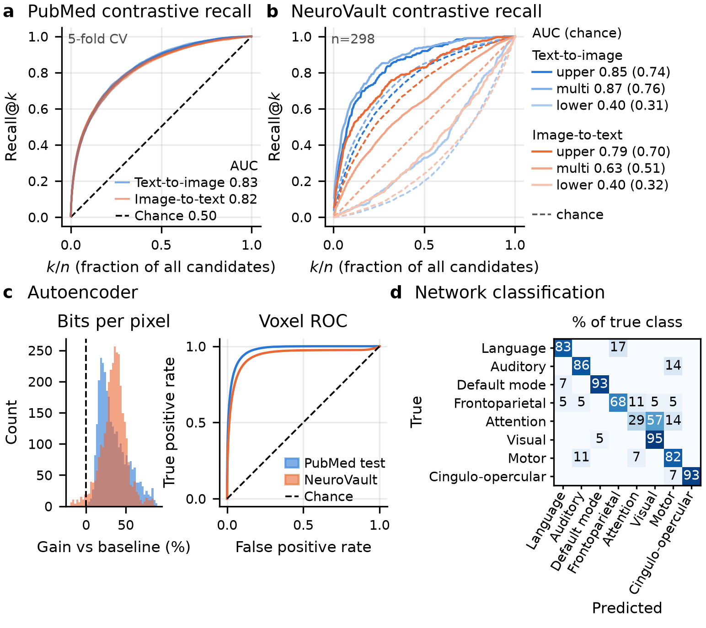
<!-- produced by ../main/fig5_perf_quant.py from a3 variant `released` (the published NeuroVault tensor with its three p-maps, two papers, rebuilt from the NIfTIs as 1 - p under the release threshold; z54, a3 README, outputs/p_maps_inverted.csv). Panel b (../main/fig5_perf_quant_text.json, check8: maps labeled Other typed, 298 papers / 3,074 maps, z103): upper 0.8468 / 0.7869 (legend 0.85 / 0.79, chance 0.74 / 0.70), multi-target 0.8663 / 0.6264 (legend 0.87 / 0.63, chance 0.76 / 0.51; 0.501 with 200 derangements, so 0.51 is Monte Carlo noise), lower 0.398 / 0.400 (chance 0.306 / 0.318); text to brain, then brain to text; before the inversion the upper bound was 0.846 / 0.787. With the 480 Other maps kept untyped (the submission's set, 305 papers / 3,154 maps) the upper bound was 0.8451 / 0.7848, which rounded to the 0.78 of earlier drafts. The submitted caption's "AUC=0.78 ... AUC=0.85" did not name its curves; the new caption (../main/README.md) names each curve. Lower bound below one half: the worst_image rule of core/a3_neurovault_bounds/run_analysis.py keeps, per paper, the map the model scores lowest for its text, a minimum over 10.3 maps per paper on average (median 6, max 100), ranked among the other papers' selected maps; with texts shuffled (20 derangements) the same rule gives 0.31 (text to brain) and 0.32 (brain to text), the model 0.40 and 0.40. -->

<a id="2.9"></a>
### 2.9: SPECTER naming
**Comment:** SPECTER, SPECTER2 and Specter are used inconsistently. Name the exact model of each component. \
Every text-encoding step uses SPECTER2, the allenai/specter2_aug2023refresh model with its ad hoc query adapter, and the original SPECTER is never used. We corrected every mention to SPECTER2. The other language models are NeuroQwen3-0.6B, which is Qwen3-0.6B adapted to PubMed titles and abstracts and writes the captions ([2.11](#2.11)), and Qwen3.5-27B, which wrote the paper summaries and the synthetic and curated texts ([2.6](#2.6)). Reviewer 1 raised the same concern ([1.6](#1.6)).
<!-- no script: text change only. Summary model as in 2.6 and the paper, Qwen3.5-27B (author, final round, replacing the z97 Llama-3.3-70B-Instruct of the neurovlm/pubmed_summary_qa dataset card, which the author corrects). Re-creation: scripts/data/09_summaries.py. -->

<a id="2.10"></a>
### 2.10: LoRA analogy
**Comment:** an MLP projection head is not a LoRA adapter. \
We agree and deleted the LoRA analogy. The head is a small network trained on frozen SPECTER2 embeddings, and the revision calls it the text-to-brain head rather than an adapter. Reviewer 1 raised the same concern ([1.7](#1.7)).
<!-- no script: text change only -->

<a id="2.11"></a>
### 2.11: Training details
**Comment:** report parameters, GPU, training time, seeds, the Qwen fine-tuning strategy, and hyperparameters. \
Table R8, the new Supplementary Table S7, gives the parameters, training data, epochs, optimizer, learning rate, batch size, seed, and training time of every component. All components except the language model train on one RTX 5090 GPU, with fixed seeds and deterministic kernels. The whole pipeline, five-fold cross-validation included, trains from scratch in about 1.8 hours.

**Qwen fine-tuning strategy.** NeuroQwen3-0.6B is Qwen3-0.6B with every weight fine-tuned, without adapters, on PubMed titles and abstracts for one epoch, which took 14 hours on one H100 GPU (Table R8). Its training script removes the validation, test, and NeuroVault evaluation papers from the corpus. Our response to Reviewer 1 reports a memorization check ([1.2](#1.2)).

| Component | Parameters | Training data (train / validation) | Epochs (selection) | Optimizer, learning rate, batch | Seed | Time |
|---|---|---|---|---|---|---|
| Autoencoder | 59.9 M | PubMed maps, 23,894 / 2,987 | 101 (lowest validation loss) | AdamW, 5e-5, 256 | 0 | 10 min |
| Contrastive heads, text and image | 0.59 M and 0.30 M | text and map latents, 23,894 / 2,987 | 301 (last) | AdamW, 1e-5, 2,048 | 123 | 6 s |
| Text-to-brain head | 0.59 M | text and map latents, 23,894 / 2,961 | 30 of at most 80 (best validation Dice) | AdamW, 1e-3, 512 | 0 | 22 s |
| Anatomically centered head | 3.8 M | synthetic pairs, 6,309 / 64, and PubMed training pairs | 200 of 2,000 (best PubMed validation recall) | AdamW, 2e-4, 2,048 | 123 | 103 s |
| Stage 1 projector (MLP) | 28.3 M | maps and LLM summaries, 22,547 / 2,837 | 4 of at most 30 (lowest validation loss, early stopping) | AdamW, 3e-4 with cosine decay, 32 | 17 | 17 min |
| Stage 2 projector (MLP) | 28.3 M | concept texts and maps, 972 / 134 | 30 (last) | AdamW, 1e-4 with cosine decay, 18 | 3 | 5 min |
| NeuroQwen3-0.6B | 596 M | PubMed titles and abstracts, 1.22 M / 12,317 (385 M tokens) | 1 | AdamW, 5e-6 with cosine decay, 16 sequences of 1,024 tokens, bf16 | 12345 | 14 h (one H100) |

<!-- no script yet: per-stage numbers in scripts/README.md ("Training", "Final run") and the stage summaries in scripts/outputs/runs/final/*.summary.json. Training time measured in both reproduction runs with the previous stage-14 settings (scripts/README.md "Determinism and proof"): stages 08-14 with five stage-14 seeds 3,386 / 3,353 s, five-fold CV (stage 20) 2,908 / 2,868 s, 6,294 / 6,221 s in all (1.75 / 1.73 h; deterministic kernels; data download, validation and figures excluded). The current stage-14 settings take 1,502 s for five seeds (296-306 s each) instead of 1,316 s (251-271 s) (scripts/models/README.md, "Salience (Fig. 2)"), so training in all takes about 6,480 s (1.8 h); measured in the two proof runs of 2026-10-10/11: stages 08-14 3,377 / 3,399 s, stage 20 (five folds) 2,847 / 2,850 s. The autoencoder trains 101 epochs (08_autoencoder.summary.json; the paper says 100), the InfoNCE heads 301. Details dropped from the old caption (for the supplementary table): fp32 weights with TF32 matrix products, projectors under bf16 autocast; frozen SPECTER2 (111 M); the text-to-brain head's validation leaves out the 26 audit papers; losses: autoencoder binary cross-entropy; contrastive heads symmetric InfoNCE (temperature 0.07; the text head starts from a voxel-wise head, 17 s more); text-to-brain head latent error plus voxel-correlation terms; anatomically centered head synthetic-pair loss plus the text-to-brain loss on PubMed training pairs, learning rate halved on plateaus; projectors next-token cross-entropy through the frozen NeuroQwen3-0.6B (stage 1 adds an alignment term and 5 % warm-up; stage 2 weighs title tokens five times), stage 2 trained with seeds 1-5 and the lowest final validation loss kept; the five CV folds (48 min) reuse the autoencoder and head settings. -->
<!-- z61: NeuroQwen3-0.6B facts (efficient_ai/project/notebooks/01_dapt.ipynb): full-parameter continued pretraining of Qwen/Qwen3-0.6B (post-trained checkpoint) with TRL SFTTrainer on plain text, loss on every token, no LoRA and nothing frozen; PubMed E-utilities neuroimaging query, 1990-01-01 to 2026-02-26, 1,231,613 records (title, blank line, abstract), random 1 % validation (seed 12345): 1,219,296 / 12,317; 385,468,745 training tokens; packing into 1,024-token sequences, 8 per device x 2 accumulation = 16,384 tokens per step (~23.6 k steps); lr 5e-6 peak, cosine, 10 % warm-up, weight decay 0.01, max_grad_norm 0.3; AdamW (Trainer default); bf16; one H100 on Colab; wall time and final losses not recorded. Overlap: 2,906 of the 2,971 evaluated test papers are in the corpus, 2,878 in its training portion (z53/overlap.py). Parameters: 596 M as loaded by NeuroVLM (transformers 4.57 ties lm_head to the trained embeddings; the checkpoint stores a separately trained lm_head, 752 M values in all). -->
<!-- z72: "We did not retrain it" and the overlap sentence replaced by the exclusion sentence, Table R8 row label "(not retrained)" dropped. After the retrain update the row (corpus size, GPU, time) and the first sentences of this paragraph. -->

<a id="2.12"></a>
### 2.12: Random results and failure cases
**Comment:** Figs. 2 and 3 show selected examples. Add randomly selected results and representative failure cases. \
We added random results and failure cases for every evaluation set. In the manuscript, Fig. 3 draws its rows by a fixed rule from the high, medium, and low thirds of the similarity distribution, and its Low rows are failure cases ([3.9](#3.9)). Fig. R11 shows the six worst brain-to-text cases on the PubMed test set. Random PubMed test papers, the worst text-to-brain cases, the weakest atlas networks, and NeuroVault papers that fail on their best-matching map are in the code repository [author: or name the supplementary figure that holds them]. Failures are common, with 16% of PubMed test-set captions scoring a negative similarity to the paper's text.

**Data and model failures.** Many failures start in the data. For 37% of the failing maps, the paper's own text and map are among the least similar pairs of the PubMed test set, against 5% of the successful maps, and Neurosynth, which shares nothing with NeuroVLM, also predicts these maps poorly from their text. Maps with few or scattered foci fail no more often than others. The remaining failures are model misses.
<!-- core/a7_failure_cases_percentiles/failure_decomposition.py (outputs/failure_decomposition.md): mismatch = true-pair cosine of title + abstract with the paper's map below the test-set 10th percentile; 180 of 482 failures (37.3 %) against 22 of 482 random non-failures (4.6 %); poor input map 28.8 % against 28.6 %; model misses (clean, consistent) 205 (42.5 %); Neurosynth r < its 10th percentile 31.3 % against 5.0 % -->

**Invented names.** The failure cases showed invented network and region names in the titles. Title decoding is steered toward canonical names. At the title position, tokens that cannot continue a canonical network or region name are masked, and the model's own probabilities choose among the rest.

**Body text.** The body text and [FUNCTION] titles are generated without this mask and can contain invented words or stray fragments, such as "useary" in Fig. R11. The Discussion states this limitation.

**Non-Latin text.** A few captions contained non-Latin characters, which come from the language model's multilingual vocabulary. Decoding is restricted to Latin-script tokens.
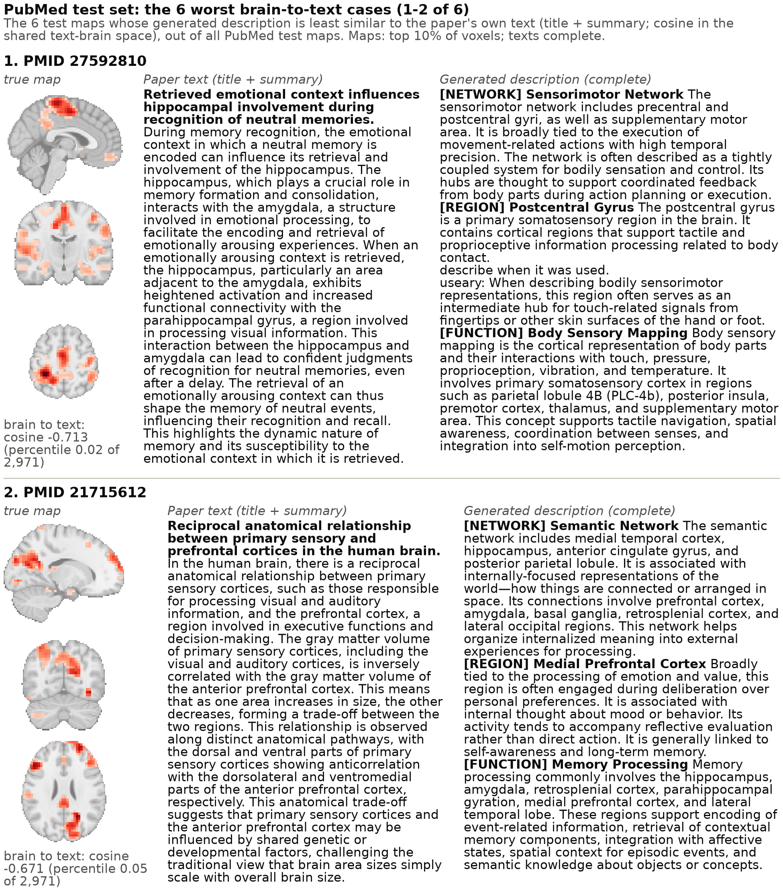
<!-- produced by core/a7_failure_cases_percentiles/make_figure.py (three pages, two cases each, since check8; text 7.5 pt on page 1, 8 pt on pages 2 and 3; only this set is in the letter, the other five sets (worst text-to-brain, random, weakest networks, NeuroVault best-case failures in both directions) are in reviewer_02/; cases: run_analysis.py; 16 %, 482 of 2,971 (z65; 474 / 476 before the calibration), b2t_text_cos < 0 in outputs/pubmed_items.parquet; final model with the retrained stage 14 and Latin-script decoding (2026-10-12); generated maps calibrated, one factor per model). Invented names (z54; a7 audit_names.py -> outputs/name_audit_titles.csv): "Cerebro-Cervico-Brain" is the free-decoded [NETWORK] title of worst case 2 (PMID 32595302), "Medial Personal Relevance Cortex" the [REGION] title of worst case 3 (PMID 21715612); with unsteered title decoding (before the title mask; the text's 23 % / 9 %), of the 2,971 stage-2 test captions 827 [NETWORK] titles (28 %) and 300 [REGION] titles (10 %) were no bank title, 678 (23 %) and 259 (9 %) no atlas name either; the steered default with the title mask (validation/final, regenerated audit) gives 0 / 0. Titles steered to the canonical names by the title mask (a6 --title-constraint vocab; 48 network and 83 region names, a6 outputs/title_vocabulary.json): 100 % canonical, title accuracy unchanged or higher (3.6), no speed cost; the two titles become "Cerebro-Cerebellar Network" and "Medial Prefrontal Cortex" (a6 worst_case_titles.csv). Bodies are not masked: 14 % of test captions (1,216 of 8,913 texts) hold a phrase with a word found in no atlas or bank name (e.g. "parahippocampestral limbic system"). Fig. R11 is drawn from the steered captions with the title mask (z65, unchanged in z66); the 16 % holds (482 of 2,971). Non-Latin text: before the Latin-script restriction 78 captions held CJK characters (scripts/README.md 'Generation', details in scripts/models/README.md 'Generation'). -->
<!-- z47/z97: 'in the code repository' = scripts/figures/review/reviewer_02/ (2.12_pubmed_random, _pubmed_t2b_worst, _networks_bottom, _neurovault_b2t_best, _neurovault_t2b_best, each .png/.svg with its _p2.. pages). AUTHOR: reviewer_0*/ is in .gitignore, so these files must be committed (git add -f) for the sentence to hold -->

## Reviewer 3

<a id="3.0"></a>
### 3.0: Summary
**Comment:** summary of the framework and its results, no action requested. \
This summary is accurate. Our responses to the comments follow ([3.1](#3.1) to [3.10](#3.10)).

<a id="3.1"></a>
### 3.1: Novelty and what the model learns
**Comment:** clarify the novelty by showing why generation and context matter, and interpret what the model learns. \
Generation and context both matter, and the model learns interpretable associations between terms and brain maps.

**1. Generation and context.** Generation matters. Generated maps match each test paper's map better than the nearest training paper's map does (Reviewer 1, [1.1](#1.1)). Generated captions are as close to the paper's text as retrieved captions and rarely report another study's details, which retrieved captions often do ([3.3](#3.3)). Context matters too. SPECTER2 beats a context-free word2vec encoder on every measure, by a modest margin ([3.4](#3.4)).

**2. What the model learns.** The shared latent dimensions are interpretable, since each clear dimension decodes to a map that matches the Neurosynth map of its top term ([3.5](#3.5)). Swapping one word in a text moves the generated map toward the matching Neurosynth contrast, but negation has no effect, so the model composes terms additively. Against previous meta-analysis methods, NeuroVLM gives closer text-to-brain maps than Neurosynth and NeuroQuery ([3.2](#3.2)).
<!-- no script: points to 1.1 and 3.3 to 3.5. Nearest training paper vs NeuroVLM (a1 results_table_full.csv): Dice 0.395 vs 0.531, r 0.114 vs 0.322. Captions (a2 table.csv): MiniLM 0.463 vs 0.428, BERTScore 0.553 vs 0.588; study details 1.7 % vs 56.5 %. word2vec (a5_encoder_swap): mean AUC 0.809 vs 0.834, Dice 0.516 vs 0.530, r 0.307 vs 0.327. Latent dimensions: a6_latent_interpretation. -->
<!-- z61 (check5 3.1, the "awful sentence" was this response, z56/head 3.assessment): rewritten in short sentences, no colons or semicolons; 'Comparisons with existing methods are in 3.2' left out to stay under 70 words -->

<a id="3.2"></a>
### 3.2: Comparison with existing methods
**Comment:** compare with methods beyond NiCLIP and NeuroConText, or stress what NeuroVLM can do that others cannot. \
NeuroVLM improves on existing methods in both respects, with higher performance and more capabilities.

**1. Direct comparisons.** Each method turns a test paper's title and abstract into a map, which is scored against that paper's map (Fig. R1). NeuroVLM gives the closest maps, ahead of Text2Brain, NeuroQuery, and Neurosynth (Dice 0.53 against at most 0.49). In retrieval, NeuroVLM is slightly ahead of NiCLIP and NeuroConText on the test papers that neither was trained on (Fig. R12).

**2. New capabilities.** We know of no other model that writes text from group-level brain maps. NeuroVLM also retrieves and generates in both directions through one shared space, and its generated maps and captions match or beat retrieved ones ([3.3](#3.3)). The Introduction states these capabilities.
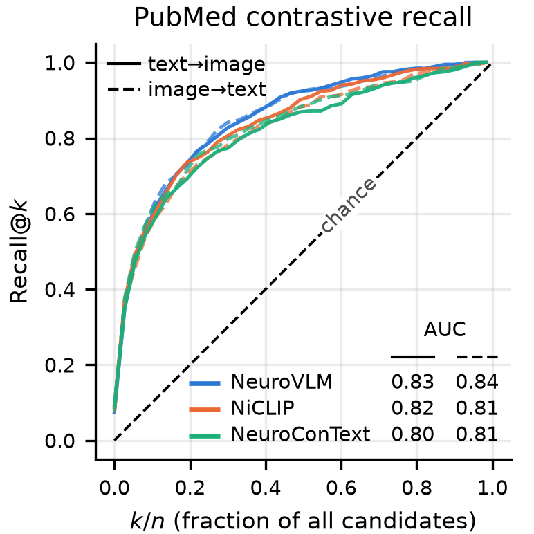
<!-- produced by core/a1_text_to_brain_baselines/make_figure.py (text_to_brain_baselines_table.csv: Dice / r NeuroVLM (non-linear head) 0.531 / 0.322, NeuroVLM (linear head, ridge) 0.526 / 0.311, Neurosynth 0.418 / 0.175, NeuroQuery 0.411 / 0.179, Text2Brain 0.485 / 0.293; every other baseline <= 0.448). Fig. S3 (../main/figS3_recall_comparison_text.json, 366 test papers in neither baseline's training set): NeuroVLM AUC 0.834 / 0.835, NiCLIP 0.823 / 0.807, NeuroConText 0.801 / 0.813. Neurosynth and NeuroQuery are used as released; 1,814 of the 2,971 test papers are in one of their corpora (z53 facts 4), which can only favor them. The letter repeats Fig. R1 with \capbaselines (its length depends on the Reviewer 1 caption pass) -->

<a id="3.3"></a>
### 3.3: Generation versus retrieval and granularity
**Comment:** show that generated outputs beat retrieved ones, check whether the decoder or the canonical projection collapses the outputs, and quantify granularity. \
Generated outputs are at least as accurate as retrieved ones. The decoder does not collapse, although the canonical projection pulls about one caption in ten toward a prototype, and we quantify the granularity of the outputs below. Reviewer 1 raised the same comparison ([1.1](#1.1)).

**1. Generated versus retrieved outputs.** Generated maps are closer to each test paper's map than the retrieved map, the nearest training paper's map (Table R1). By MiniLM cosine, generated captions are at least as close to the paper's text as the nearest training caption (Table R9 and Fig. R13b). BERTScore favors training captions, even random ones, for their summary style. Retrieved captions often carry another study's details, and generated captions rarely do (57% against 2%).

**2. Collapse.** The decoder does not collapse to a fixed set of outputs. Over 99% of stage 2 test captions are unique, against 73% of retrieved captions (Table R9). The language model generates every caption, and only the network and region titles are steered toward canonical names, by masking tokens that cannot continue one (Reviewer 2, [2.12](#2.12)). The body text is not masked.

**3. Canonical projection.** The canonical projection pulls captions toward its prototypes. With it, about one caption in ten nearly copies a curated training text, against almost none without it (Fig. R13c). This is the price of the drop in study details under point 4, and the Methods state the trade-off.

**4. Granularity.** Yes. We quantify granularity by the spread of titles and by the study detail in the body text. Test captions use nearly every canonical network and region name, and no single title is given to more than one test map in ten. The share of captions that name a study detail, such as a sample size, patient group, or task, falls from 36% at stage 1 to 2% at stage 2 (Fig. R13a). Stage 2 captions describe the map, not a single study.
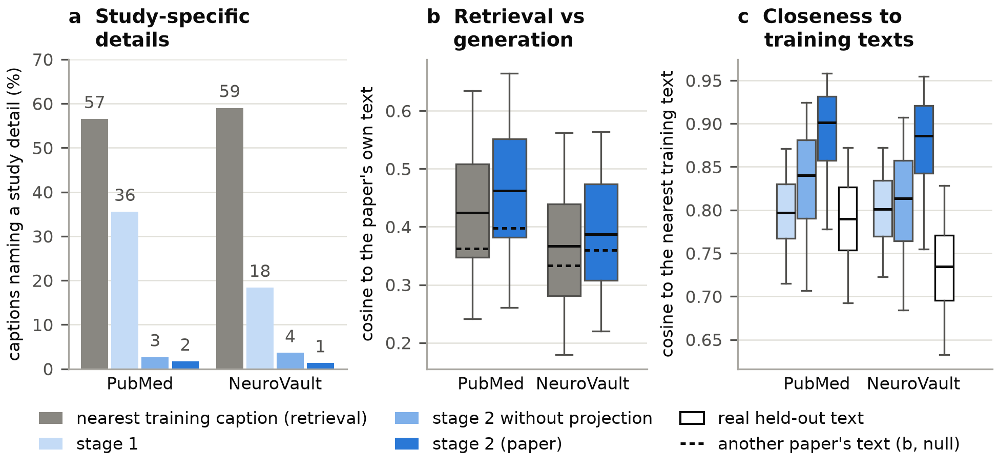
<!-- produced by core/a2_granularity_tradeoff/make_figure.py (captions: run_analysis.py, final run; numbers in outputs/metrics.json and outputs/table.csv, PubMed test set, n = 2,971): study-detail share (lex_any_frac) retrieved 0.565, stage 1 0.355, stage 2 without the projection 0.027, stage 2 0.017 (mostly patient groups: lex_clinical_frac retrieved 0.382, stage 2 0.008); unique captions (unique_frac_text) 0.994 (stage 1 0.969, retrieved 0.733; Table R9 column Unique); near-copies (MiniLM cosine >= 0.95 to a training text) 0.099 with the projection, 0.006 without, 98.4 % of nearest neighbors are stage 2 training texts (the 1,338 curated texts); MiniLM to the paper's title + LLM summary 0.463 (stage 2) vs 0.428 (retrieved), BERTScore 0.553 vs 0.588; a random training text scores BERTScore 0.580 (core/a1_brain_to_text_baselines), so BERTScore rewards style more than content. Every PubMed caption is generated at batch 128 (generation_sources in metrics.json). Retrieved = title + LLM summary of the training paper nearest to the map in the shared space; the summaries were written by Qwen3.5-27B (2.6) -->
<!-- z94 (z93 E12): output space = core/a2_granularity_tradeoff/outputs/generated_pubmed_stage2.csv, first line of each section: 48 of 48 canonical network titles and 74 of 83 region titles used (122 of 131), 567 distinct function titles, most frequent title Frontoparietal Control Network on 289 of 2,971 maps (9.7 %). Recount after any caption regeneration. -->
<!-- z61 (check5 3.2): rewritten without colons or semicolons, one paragraph per question of the reviewer (generated vs retrieved, collapse, granularity) -->

<a id="3.4"></a>
### 3.4: Context-free baseline
**Comment:** compare the language-model encoder with a context-free baseline such as mean word2vec embeddings, for retrieval and text-to-brain. \
SPECTER2 outperforms a context-free baseline on both tasks, by a modest margin (Fig. R14). We replaced SPECTER2 with the mean word2vec embedding of each title and abstract and retrained only the projection heads. Mean retrieval AUC, the area under the recall curve, is 0.83 against 0.81. Text-to-brain Dice and voxel correlation are also higher with SPECTER2. We added this comparison to the Discussion and the Supplementary Information. \
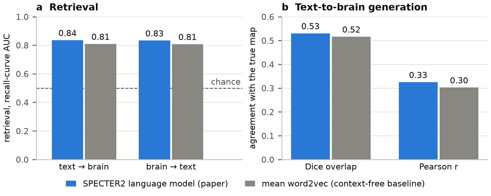
<!-- produced by core/a5_encoder_swap/make_figure.py (heads: run_analysis.py, retrained on the final autoencoder's latents with the final training settings, text-to-brain head v2, one seed; word2vec GoogleNews 300-d, 87 % of words covered; outputs/table.csv: SPECTER2 vs word2vec AUC 0.835 / 0.833 vs 0.809 / 0.808, mean 0.834 vs 0.809, Dice 0.530 vs 0.516, r 0.325 vs 0.303; the SPECTER2 row reproduces the final heads, 0.836 / 0.833, Dice 0.531) -->

<a id="3.5"></a>
### 3.5: Interpretation, perturbations, and ablations
**Comment:** interpret the encoder weights, perturb the inputs (for example with negation), and ablate the cross-entropy loss and the canonical projection. \
The shared latent dimensions are interpretable, word swaps move the generated map but negation does not, and the cross-entropy loss matters most for retrieval.

**1. Encoder weights.** The encoder weights act on SPECTER2 features that have no fixed meaning, so we interpret the latent dimensions that texts and maps share instead. For the clearest dimensions, the decoded map matches the Neurosynth map of the dimension's top term, such as listening in superior temporal cortex (Fig. R15, r = 0.65). The text and brain sides agree on what each dimension means. This figure is new in the Supplementary Information.

**2. Perturbations.** Word swaps and joined concepts move the map as expected, but negation does not (Fig. R16). Swapping one word moves the map toward the matching Neurosynth contrast, and joining two concepts covers both. A sentence and its negation give nearly the same map (r = 0.84 to 1.00). NeuroVLM therefore does not go beyond linear additivity, and the Discussion states this limitation.

**3. Ablations.** Table R10, new in the Supplementary Information, ablates the losses. The cross-entropy loss matters most for retrieval, since retrieval AUC drops from 0.83 to 0.62 without it, while the temperature and a one-directional loss barely matter. The final text-to-brain head beats heads trained with the other losses. Our response to [3.3](#3.3) gives the effect of the canonical projection on captions.
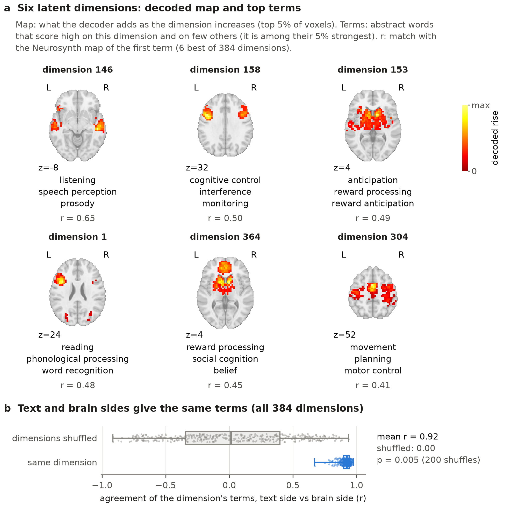
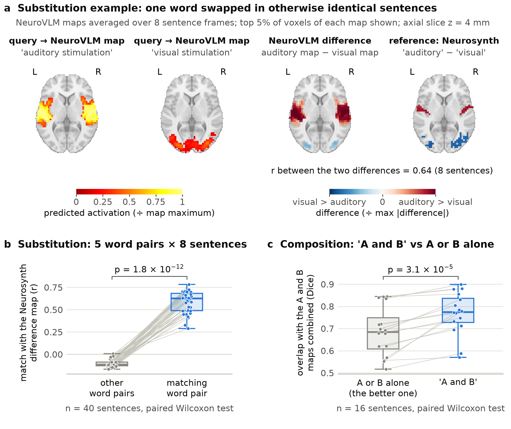
<!-- produced by core/a6_latent_interpretation/make_figure.py (dimensions: select_dimensions.py); probes: core/a6_perturbation_probes/make_figure.py; loss table: core/a5_loss_ablation/make_figure.py. All three use the final model. Latent dimensions: 146 listening (superior temporal, r 0.65), 158 cognitive control, 153 anticipation, 1 reading, 364 reward processing, 304 movement; 106 of 384 dimensions reach r >= 0.3; panel b, text vs image term profiles 0.92 vs 0.00 shuffled (p = 0.005, 200 shuffles). Probes (head v2, calibrated maps): word swaps r 0.59 vs -0.10 with other pairs' contrasts, higher in 40 of 40; 'A and B' Dice 0.77 vs 0.69, higher in 16 of 16; negation r 0.84 to 1.00 between a sentence and its negation, mean 0.95 (0.84 is the word-order swap 'auditory but not visual'; outputs/negation_items.csv, table_negation_context.md); nothing tests super-additive composition. Loss table (final latents, 3 seeds, test set): contrastive 0.833 vs 0.618 without cross-entropy, other variants within 0.011; text-to-brain Dice head v2 0.530, latent MSE 0.512, voxel-wise BCE 0.491, latent cosine 0.385 (outputs/a5_loss_ablation_text_to_brain.csv); the final head also differs in optimizer settings, epochs and model selection. The letter merges the two loss tables into one -->
<!-- z61: OPEN_ITEMS.md (author): 'a sentence on negation (3.4); the reviewer asked for the ablations in the supplement (currently letter-only). > Add.' Old 3.4 = 3.5, so the negation sentence and the loss-ablation table go to the paper (changes line) -->

<a id="3.6"></a>
### 3.6: Network, anatomy, and cognition outputs
**Comment:** compare performance across the network, region and function outputs, and generate maps from network-only, anatomy-only or cognition-only text. \
[REGION] and [FUNCTION] titles are correct more often than [NETWORK] titles, and maps generated from one kind of text alone beat a null baseline. Every title is generated by the language model, with [NETWORK] and [REGION] titles steered toward canonical names by masking tokens that cannot continue one (Reviewer 2, [2.12](#2.12)).

**1. Comparison of the three outputs.** A [NETWORK] title is correct if it names the map's network, a [REGION] title if it names a region inside the map, and a [FUNCTION] title if it names a function that [author: how a function is decoded from the map, e.g. "Neurosynth decoding of the map ranks in its top terms"] (Fig. R17). On PubMed test maps, [REGION] titles are correct most often (63% against 24% by chance) and [NETWORK] titles least. Fig. R17 also scores atlas networks and ICA components.

**2. Network, anatomy, or cognition text only.** Maps generated from a network name, a region name, or a cognitive term alone all match their references better than a null baseline (Table R11). Region maps overlap their references least, because most regions are smaller than the top 10% of voxels that Dice compares. \
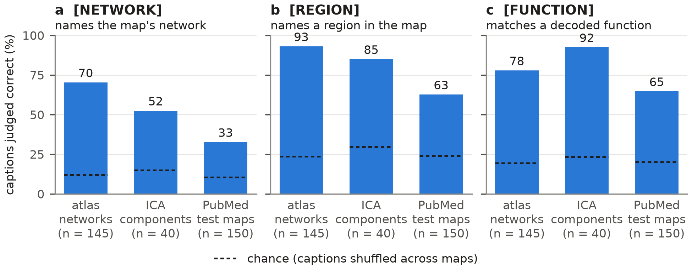
<!-- produced by core/a6_steering_tokens/plot_correctness.py (captions: run_correctness.py). Titles: generated with the title mask that steers them to the canonical names (run_correctness.py --title-constraint vocab; check5 decision: the default for the paper), [NETWORK] / [REGION] titles from the 48 / 83 canonical names of the final run's stage-14 banks (outputs/title_vocabulary.json); bodies and [FUNCTION] are not masked. Numbers with the constraint, the default since z66 (outputs/correctness_table.csv; atlas networks / ICA / PubMed, 145 / 40 / 150 maps, containment rule): [REGION] 0.931 / 0.850 / 0.627 vs chance 0.236 / 0.297 / 0.241; [NETWORK] 0.703 / 0.525 / 0.327 vs 0.121 / 0.149 / 0.104; [FUNCTION] 0.779 / 0.925 / 0.647 vs 0.194 / 0.234 / 0.201 (unchanged); all p_perm < 0.001; 100 % of [NETWORK] / [REGION] titles are canonical (free decoding: 73 to 95 %). The text's 63% / 24% = [REGION] PubMed 0.627 / chance 0.241. Fig. R17 shows this steered run; the free baseline is outputs/title_none (canonical titles 73 to 95 %). Correctness: [REGION] names a region (Harvard-Oxford, AAL or Pauli) holding >= 5 % of the map's top voxels (top 10 % of a PubMed map), its peak, or a region at least half inside them; [NETWORK] names the atlas label or, for unlabeled, ICA and PubMed maps, the Yeo-7 network holding most top voxels; [FUNCTION] shares a synonym group with a top-5 Neurosynth-decoded term; chance = titles shuffled across maps (5,000 permutations). Text-only inputs: core/a6_modality_restricted_t2b/make_figure.py (final text-to-brain head v2, calibrated maps, independent of stage 14; outputs/modality_table.md: Dice 0.29 / 0.07 / 0.28 vs null 0.05 / 0.01 / 0.13, all p < 1e-15). Region Dice is capped because a small ROI (median about 160 voxels) cannot fill the 2,854-voxel top 10 % (size-matched Dice 0.09 vs 0.01, README) -->

<a id="3.7"></a>
### 3.7: Unsupported claims
**Comment:** both claims ("modular and interchangeable", line 101, and "limiting factor", line 672) need scaling or ablation support, or softer wording. \
We narrowed both claims to what the study supports.

**1. Modular and interchangeable components.** The sentence claims only that the text encoder can be swapped by retraining the small projection heads. The encoder swap of [3.4](#3.4) shows this, where replacing SPECTER2 with word2vec cost a modest drop in performance (Fig. R14). The reference to larger or smaller models is removed, because we tested no scaling.

**2. Limiting factor.** The sentence was meant to contrast coordinate-based supervision with full statistical maps. It is rewritten to say exactly that, with citations on what coordinate-based meta-analysis loses, and no longer claims a general limiting factor.
<!-- no script: points to 3.4 (core/a5_encoder_swap) -->

<a id="3.8"></a>
### 3.8: Titles and abstracts only
**Comment:** justify training only on titles and abstracts rather than, for example, table captions. \
Titles and abstracts exist for every paper, but table captions exist only for the papers with open-access full text, fewer than half. Captions also say little about where the coordinates lie, so they cannot check the abstract's claims (Table R12). A classifier that predicts a table's main region from its caption performs at chance (macro-F1 0.06 against 0.05), while the same classifier does better from the abstract. The Discussion gives these reasons.

| Kind | Caption | Where its coordinates lie |
|---|---|---|
| boilerplate | Brain regions revealed by contrasts of interest. | anterior cingulate, frontal pole, insula |
| boilerplate | The main results of group analysis of block data. | posterior cingulate, amygdala, thalamus |
| boilerplate | Regional imaging relationships. | lateral occipital cortex, precuneus |
| condition code | Simple Effects contrast JUDGE –BODY. | anterior cingulate, lateral occipital, postcentral |
| condition code | Neural activations for the contrast AU > OC. | lateral occipital, paracingulate, posterior cingulate |
| statistics only | Functional results (p = .05 family-wise error (FWE) cluster corrected). | lateral occipital, pallidum |
| statistics only | Significant clusters exhibiting interactions of interest at p < 0.001 (uncorrected), n = 15. | insula, paracingulate, orbitofrontal |
| region list only | Significant clusters from amygdala connectivity analyses. | medial frontal cortex, insula |

<!-- produced by core/a4_caption_audit/more_bad_examples.py and caption_usability.py (numbers and figure: make_figure.py). Fewer than half: 12,204 of 30,826 corpus papers (39.6 %) are in PMC open access. Caption macro-F1 0.060 [0.040, 0.079] vs chance 0.049 [0.033, 0.068]; title + abstract 0.165 [0.125, 0.198]; caption + abstract 0.142, no gain over the abstract; 651 test tables (outputs/caption_decodability.md). Captions do name the task (67 % match the abstract's task vs 7 % by chance, caption_usability.json) but rarely a region (10 %). The 8 examples were picked by hand from 60 seeded examples. Discussion: the reasons above and the pooling of all tables of a paper as a limitation (check4 3.7) -->

<a id="3.9"></a>
### 3.9: Percentiles of the qualitative examples
**Comment:** report where the Fig. 2 and Fig. 3 examples fall in the similarity distribution. \
Table R13 gives each example's percentile within its set, from the 16th to the 99th, and Fig. 3 plots both similarity distributions with each example marked. The rows of Fig. 3 follow a fixed rule. Each third of the distribution contributes the papers nearest its center that have a clean generated text, and the High and Medium rows also require a title that names one domain and a true map with distinct clusters.

| Example | Text → brain percentile | Brain → text percentile |
|---|---|---|
| Fig. 3, High, working memory | 86 | 79 |
| Fig. 3, High, language | 77 | 87 |
| Fig. 3, Medium, memory | 52 | 62 |
| Fig. 3, Medium, reward | 36 | 43 |
| Fig. 3, Low, poor input map | 16 | 18 |
| Fig. 3, Low, model miss | 22 | 19 |
| Fig. 2, Visual | 76 | 99 |
| Fig. 2, Language | 75 | 37 |
| Fig. 2, Auditory | 31 | 19 |
| Fig. 2, Somatomotor | 39 | 72 |
| Fig. 2, Interoception | 44 | 55 |
| Fig. 2, Default mode | 69 | 94 |
| Fig. 2, Frontoparietal control | 48 | 53 |
| Fig. 2, Salience | 33 | 46 |

<!-- produced by core/a7_failure_cases_percentiles/make_figure.py (outputs/captions.tex; percentiles: run_analysis.py) and ../main/fig3_newgen.py (Fig. 3 rows and density strips). Final model (retrained stage 14), calibrated maps, canonical titles (z66). Fig. 3 is one page since check6 (z81), rows rechosen in check7 (z91): 30, 150 (High), 52, 117 (Medium), 92, 53 (Low), picked by select_rows in ../main/fig3_newgen.py (nearest the third's center among papers with a clean generated text; High and Medium also need a title naming exactly one domain and a clean true map at the top-5 % display rule; low_check labels row 92 a poor input map and row 53 a model miss on a clean map), at P86, 77, 52, 36, 16, 22 (text to brain) and P79, 87, 62, 43, 18, 19 (brain to text) of the figure's 305-paper pool (fig3_newgen_text.json); Fig. 2 maps P31-P76 of 119, descriptions P19-P99 of 145; Fig. S4 components P6-P99 of 40. Percentile = 100 x (#below + 0.5 #ties) / n. -->

<a id="3.10"></a>
### 3.10: Code availability
**Comment:** positive, no action requested. \
We also made the reproducibility changes described in our response to Reviewer 1 ([1.11](#1.11)).
<!-- no script; as 1.11. Coverage: `coverage report` with .coveragerc lists 58 files (26 scripts + 32 library modules; z111 smoke run of 2026-10-14, reproduction-code coverage 36.6 %). Smoke test: scripts/pipeline/common.py SmokeCaps.max_batches = 1, so CI (.github/workflows/smoke.yml) trains each of stages 08, 09, 20 fold 0, 11, 12, 13 and 14 for one epoch of one batch on CPU; z62 ran it (all stages exit 0, 5 min). -->
