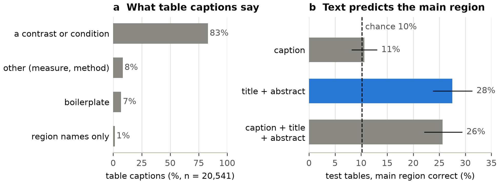

# Reviewer 3

Each comment, our response (copied from [`../RESPONSE.md`](../RESPONSE.md)) and the figure / table files used, copied here and named by comment.  Rebuilt by `../build_reviewer_dirs.py`; edit RESPONSE.md, not this file.

## 3.0: Summary

**Comment:** summary of the framework and its results, no action requested.

**Response:** No change was requested.

## 3.1: Novelty and what the model learns

**Comment:** clarify the novelty by showing why generation and context matter, and interpret what the model learns.

**Response:** **1. Generation and context.** Generated maps match each test paper's map better than the map of the nearest training paper ([1.1](../reviewer_01/README.md#1.1)). By MiniLM cosine, generated captions are as close to the paper's text as retrieved captions. Retrieved captions often report details of another study, and generated captions rarely do ([3.3](#3.3)). Context also matters, since SPECTER2 beats a context-free word2vec encoder on every measure, by a modest margin ([3.4](#3.4)).

**2. What the model learns.** Decoded latent dimensions match the Neurosynth maps of their top terms ([3.5](#3.5)). Swapping one word moves the generated map toward the matching Neurosynth contrast, but negation has no effect. The cross-entropy loss matters most for retrieval.

## 3.2: Comparison with existing methods

**Comment:** compare with methods beyond NiCLIP and NeuroConText, or stress what NeuroVLM can do that others cannot.

**Response:** **1. Direct comparisons.** NeuroVLM gives the best text-to-brain maps, narrowly ahead of linear regression and ahead of Text2Brain, NeuroQuery, and Neurosynth (Fig. R1). Each method turns a test paper's title and abstract into a map, which is scored against that paper's map (Dice 0.53 against at most 0.49). In retrieval, NeuroVLM is slightly ahead of NiCLIP and NeuroConText on test papers that neither was trained on (Fig. R12).

**2. New capabilities.** NeuroVLM is, to our knowledge, the only model that writes text from group-level brain maps. It retrieves and generates in both directions through one shared space. Its generated maps and captions match or beat retrieved ones ([3.3](#3.3)). The Introduction emphasizes these capabilities.

*Fig. R12.* New Fig. S3. Recall@k for NeuroVLM (blue), NiCLIP (orange), and NeuroConText (green) on the 366 PubMed test papers that none of the three models was trained on. Solid lines are text to image and dashed lines image to text.

Files: [`3.2_text_to_brain_baselines.png`](3.2_text_to_brain_baselines.png), [`3.2_text_to_brain_baselines.svg`](3.2_text_to_brain_baselines.svg), [`3.2_figS3_recall_comparison.png`](3.2_figS3_recall_comparison.png), [`3.2_figS3_recall_comparison.svg`](3.2_figS3_recall_comparison.svg).
Source: `core/a1_text_to_brain_baselines/outputs/text_to_brain_baselines.{png,svg}`, `../main/figS3_recall_comparison.{png,svg}`.

## 3.3: Generation versus retrieval and granularity

**Comment:** show that generated outputs beat retrieved ones, check whether the decoder or the canonical projection collapses the outputs, and quantify granularity.

**Response:** **1. Generated versus retrieved outputs.** Generated maps are closer to each test paper's map than retrieved maps ([1.1](../reviewer_01/README.md#1.1)). By MiniLM cosine, generated captions are at least as close to the paper's text as the nearest training caption (Table R11). BERTScore favors training captions, even random ones, because they share the reference's summary style. Retrieved captions often carry another study's details, and generated captions rarely do (57% against 2%).

**2. Collapse.** The decoder does not collapse to a fixed set of outputs, since over 99% of test captions are unique (Fig. R13). The language model generates every caption. Network and region titles are steered to canonical names by design, by masking tokens that cannot continue one ([2.12](../reviewer_02/README.md#2.12)). The body text is not masked.

**3. Canonical projection.** The canonical projection does pull captions toward its prototypes, as the reviewer suspected. With it, about one caption in ten nearly copies a curated training text, against almost none without it. We added this trade-off to the Methods.

**4. Granularity.** In the output space, test captions use nearly all canonical network and region names, and no title labels more than one test map in ten. The share of captions naming a study detail, such as a sample size, patient group, or task, falls from 36% at stage 1 to 2% at stage 2 (Fig. R13). Stage 2 captions describe the map rather than a single study.

*Fig. R13.* Granularity of generated captions. Captions of PubMed test maps and NeuroVault papers, retrieved or generated at each stage. Panels show (a) the share naming a study detail and the MiniLM cosine (b) with the paper's own text and (c) with the nearest training text.

Files: [`3.3_granularity_tradeoff.png`](3.3_granularity_tradeoff.png), [`3.3_granularity_tradeoff.svg`](3.3_granularity_tradeoff.svg), [`3.3_brain_to_text_baselines_table.md`](3.3_brain_to_text_baselines_table.md).
Source: `core/a2_granularity_tradeoff/outputs/a2_granularity_tradeoff.{png,svg}`, `core/a1_brain_to_text_baselines/outputs/brain_to_text_baselines_table.md`.

## 3.4: Context-free baseline

**Comment:** compare the language-model encoder with a context-free baseline such as mean word2vec embeddings, for retrieval and text-to-brain.

**Response:** SPECTER2 outperforms a context-free baseline on both tasks, by a modest margin (Fig. R14). We replaced SPECTER2 with the mean word2vec embedding of each title and abstract and retrained only the projection heads. Mean retrieval AUC, the area under the recall curve, is 0.83 against 0.81. Text-to-brain Dice and voxel correlation are also higher with SPECTER2. We added this comparison to the Discussion and the Supplementary Information.

*Fig. R14.* Context-free encoder. PubMed test-set performance with SPECTER2 or with the mean word2vec embedding of each title and abstract, after retraining only the projection heads. Panels show (a) retrieval AUC in both directions and (b) text-to-brain Dice and voxel correlation.

Files: [`3.4_encoder_swap.png`](3.4_encoder_swap.png), [`3.4_encoder_swap.svg`](3.4_encoder_swap.svg), [`3.4_encoder_swap_table.tex`](3.4_encoder_swap_table.tex).
Source: `core/a5_encoder_swap/outputs/a5_encoder_swap.{png,svg}`, `core/a5_encoder_swap/outputs/a5_encoder_swap_table.tex`.

## 3.5: Interpretation, perturbations, and ablations

**Comment:** interpret the encoder weights, perturb the inputs (for example with negation), and ablate the cross-entropy loss and the canonical projection.

**Response:** **1. Encoder weights.** We interpret the latent dimensions that texts and maps share, rather than raw weights. For the clearest dimensions, the decoded map matches the Neurosynth map of the dimension's top term, such as listening in superior temporal cortex (Fig. R15, r = 0.65). Text and maps agree on what each dimension means. We added this figure to the Supplementary Information.

**2. Perturbations.** NeuroVLM responds to word swaps and to joined concepts (Fig. R16) but ignores negation. Swapping one word moves the map toward the matching Neurosynth contrast, and joining two concepts covers both. A sentence and its negation give nearly the same map (r = 0.84 to 1.00). We find no evidence of composition beyond addition. We added this limitation to the Discussion.

**3. Ablations.** The cross-entropy loss matters most for retrieval. Without it, retrieval AUC drops from 0.83 to 0.62, while the temperature and a one-directional loss barely matter (Table R12). The final text-to-brain head also beats heads trained with other losses. Comment [3.3](#3.3) gives the effect of the canonical projection on captions. We added these ablations to the Supplementary Information.

*Fig. R15.* Latent dimensions. (a) Decoded maps of six latent dimensions, each labeled with its three most associated Cognitive Atlas terms and its correlation r with the top term's Neurosynth map. (b) Agreement of each dimension's term associations between the text and brain sides, against shuffled dimensions.

*Fig. R16.* Perturbation probes. (a) One word swapped, with NeuroVLM's difference map beside the matching Neurosynth contrast. (b) Match of such differences with Neurosynth for five word pairs, and (c) overlap of "A and B" maps with both concepts, against single-concept maps.

Files: [`3.5_latent_interpretation.png`](3.5_latent_interpretation.png), [`3.5_latent_interpretation.svg`](3.5_latent_interpretation.svg), [`3.5_perturbation_probes.png`](3.5_perturbation_probes.png), [`3.5_perturbation_probes.svg`](3.5_perturbation_probes.svg), [`3.5_loss_ablation_contrastive.tex`](3.5_loss_ablation_contrastive.tex), [`3.5_loss_ablation_text_to_brain.tex`](3.5_loss_ablation_text_to_brain.tex), [`3.5_negation_context_table.md`](3.5_negation_context_table.md).
Source: `core/a6_latent_interpretation/outputs/latent_interpretation.{png,svg}`, `core/a6_perturbation_probes/outputs/perturbation_probes.{png,svg}`, `core/a5_loss_ablation/outputs/a5_loss_ablation_contrastive.tex`, `core/a5_loss_ablation/outputs/a5_loss_ablation_text_to_brain.tex`, `core/a6_perturbation_probes/outputs/table_negation_context.md`.

## 3.6: Network, anatomy, and cognition outputs

**Comment:** compare performance across the network, region and function outputs, and generate maps from network-only, anatomy-only or cognition-only text.

**Response:** We scored each generated title against its map. Every title is generated by the language model, steered toward the canonical vocabulary. The canonical projection steers the model's input, and at [NETWORK] and [REGION] titles, tokens that cannot continue a canonical name are masked. The model's own probabilities choose the name, so nothing is classified or looked up ([2.12](../reviewer_02/README.md#2.12)).

**1. Comparison of the three outputs.** [REGION] and [FUNCTION] titles are correct most often and [NETWORK] titles least (Fig. R17). A title is correct if it names the map's network, a region inside the map, or a function decoded from the map. On PubMed test maps, 63% of [REGION] titles are correct, against 24% by chance. Fig. R17 also scores atlas networks and ICA components.

**2. Network, anatomy, or cognition text only.** Maps generated from a network name, a region name, or a cognitive term alone all match their references better than a null baseline (Table R13). Region maps overlap their references least, because most regions are smaller than the top 10% of voxels that Dice compares.

*Fig. R17.* Correctness of generated titles. Share of [NETWORK], [REGION], and [FUNCTION] titles judged correct for atlas networks, ICA components, and PubMed test maps. Dashed lines show chance, from titles shuffled across maps.

Files: [`3.6_steering_correctness.png`](3.6_steering_correctness.png), [`3.6_steering_correctness.svg`](3.6_steering_correctness.svg), [`3.6_steering_correctness_table.tex`](3.6_steering_correctness_table.tex), [`3.6_modality_restricted_table.md`](3.6_modality_restricted_table.md).
Source: `core/a6_steering_tokens/outputs/steering_correctness.{png,svg}`, `core/a6_steering_tokens/outputs/correctness_table.tex`, `core/a6_modality_restricted_t2b/outputs/modality_table.md`.

## 3.7: Unsupported claims

**Comment:** both claims ("modular and interchangeable", line 101, and "limiting factor", line 672) need scaling or ablation support, or softer wording.

**Response:** **1. Modular and interchangeable components.** The encoder swap of [3.4](#3.4) supports a narrower claim, which we keep. Replacing SPECTER2 with word2vec required retraining only the small projection heads, and performance dropped modestly (Fig. R14). We softened the sentence to this claim and removed the reference to larger or smaller models, since we did not test scaling.

**2. Limiting factor.** The sentence compared coordinate-based supervision with full statistical maps, not model sizes. We rewrote it to say so and cited work on what coordinate-based meta-analysis loses.

## 3.8: Titles and abstracts only

**Comment:** justify training only on titles and abstracts rather than, for example, table captions.

**Response:** Titles and abstracts exist for every paper, but table captions only for papers with open-access full text, fewer than half. Captions also say little about where coordinates lie, which limits their use for checking the abstract's claims (Table R14). A classifier predicts a table's main region from its caption at chance level (macro-F1 0.06 against 0.05), but does better from the abstract. We added these reasons to the Discussion.

| Kind | Caption | Where its coordinates lie |
|---|---|---|
| boilerplate | Brain regions revealed by contrasts of interest. | anterior cingulate, frontal pole, insula |
| boilerplate | The main results of group analysis of block data. | posterior cingulate, amygdala, thalamus |
| boilerplate | Regional imaging relationships. | lateral occipital cortex, precuneus |
| condition code | Simple Effects contrast JUDGE –BODY. | anterior cingulate, lateral occipital, postcentral |
| condition code | Neural activations for the contrast AU > OC. | lateral occipital, paracingulate, posterior cingulate |
| statistics only | Functional results (p = .05 family-wise error (FWE) cluster corrected). | lateral occipital, pallidum |
| statistics only | Significant clusters exhibiting interactions of interest at p < 0.001 (uncorrected), n = 15. | insula, paracingulate, orbitofrontal |
| region list only | Significant clusters from amygdala connectivity analyses. | medial frontal cortex, insula |

Files: [`3.8_caption_usability.png`](3.8_caption_usability.png), [`3.8_caption_usability.svg`](3.8_caption_usability.svg), [`3.8_caption_examples.md`](3.8_caption_examples.md).
Source: `core/a4_caption_audit/outputs/caption_usability.{png,svg}`, `core/a4_caption_audit/outputs/caption_examples.md`.

## 3.9: Percentiles of the qualitative examples

**Comment:** report where the Fig. 2 and Fig. 3 examples fall in the similarity distribution.

**Response:** Table R15 gives each example's percentile within its set, from the 16th to the 99th. Fig. 3 also plots both similarity distributions and marks each example. Its rows follow a fixed rule. Each third of the distribution contributes the papers nearest its center with a clean generated text. High and Medium rows also require a title that names one domain and a true map with distinct clusters.

| Example | Text → brain percentile | Brain → text percentile |
|---|---|---|
| Fig. 3, High, working memory | 86 | 79 |
| Fig. 3, High, language | 77 | 87 |
| Fig. 3, Medium, memory | 52 | 62 |
| Fig. 3, Medium, reward | 36 | 43 |
| Fig. 3, Low, poor input map | 16 | 18 |
| Fig. 3, Low, model miss | 22 | 19 |
| Fig. 2, Visual | 76 | 99 |
| Fig. 2, Language | 75 | 37 |
| Fig. 2, Auditory | 31 | 19 |
| Fig. 2, Somatomotor | 39 | 72 |
| Fig. 2, Interoception | 44 | 55 |
| Fig. 2, Default mode | 69 | 94 |
| Fig. 2, Frontoparietal control | 48 | 53 |
| Fig. 2, Salience | 33 | 46 |

Files: [`3.9_example_percentiles.md`](3.9_example_percentiles.md), [`3.9_captions.tex`](3.9_captions.tex).
Source: `core/a7_failure_cases_percentiles/outputs/a7_example_percentiles.md`, `core/a7_failure_cases_percentiles/outputs/captions.tex`.

## 3.10: Code availability

**Comment:** positive, no action requested.

**Response:** No change was requested. The reproducibility changes of comment [1.11](../reviewer_01/README.md#1.11) also apply here.
